# Ticket 01 — RDP / Remmina Connection Failure

## Issue Description

A user reported being unable to establish a Remote Desktop connection from an Ubuntu VM to a Windows 11 client using Remmina.

The goal was to identify why the connection was failing, restore Remote Desktop functionality, and verify that the Ubuntu client could connect successfully.


## Original Help Desk Ticket


The issue was documented in osTicket as ticket #966332, titled "Unable to connect to Windows PC using Remmina."

The simulated user, Alex Morgan, reported being unable to establish a remote desktop connection from an Ubuntu computer to a Windows PC using Remmina.


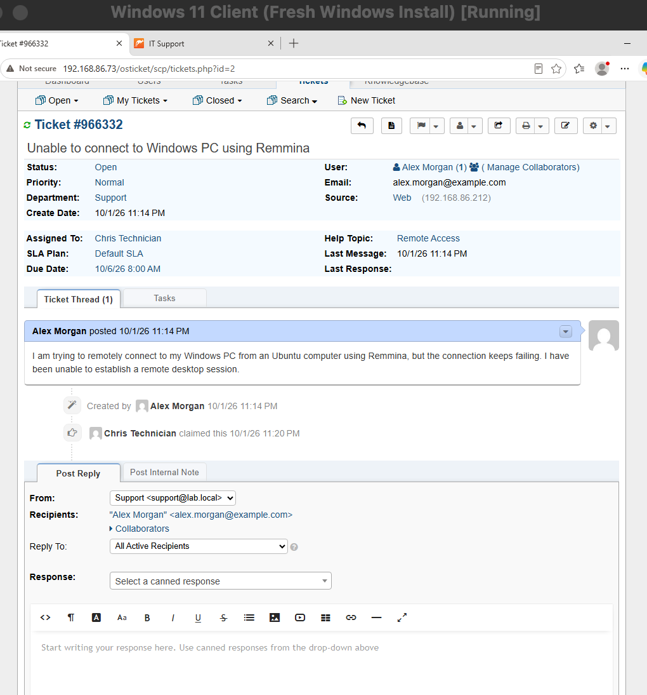


## Lab Environment

| Component | Details |
|---|---|
| RDP Host | Windows 11 Client VM |
| Remote Client | Ubuntu 25.10 VM |
| Virtualization | Oracle VirtualBox |
| Remote Desktop Client | Remmina |
| Windows Client IP | `192.168.86.212` |
| RDP Port | TCP 3389 |
| Ticketing System | osTicket |

## Troubleshooting Steps


### 1. Verified the Reported RDP Connection Issue

I attempted to connect from the Ubuntu VM to the Windows 11 client using Remmina to confirm the user's reported problem.

- Remmina displayed an error indicating it could not connect to the RDP server.
- Confirmed that the RDP connection was failing as reported.

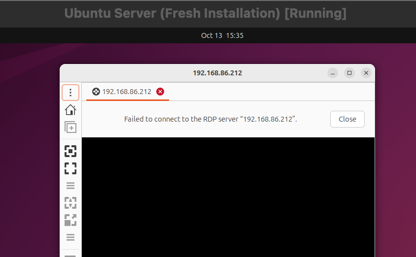


### 2. Verified Network Connectivity

I started by checking whether the Ubuntu VM could communicate with the Windows 11 client.

- Pinged the Windows client at `192.168.86.212`.
- Received 4 out of 4 replies with 0% packet loss.
- Confirmed basic IP connectivity between the two virtual machines.

This suggested that the connection failure was related to RDP rather than a general network connectivity issue.

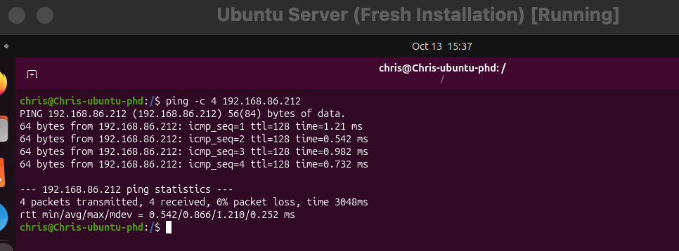


### 3. Checked the RDP Listener

On Windows 11, I checked whether Remote Desktop was listening for incoming connections.

```cmd
netstat -an | findstr 3389
```

The command returned no listening connection on TCP port 3389.

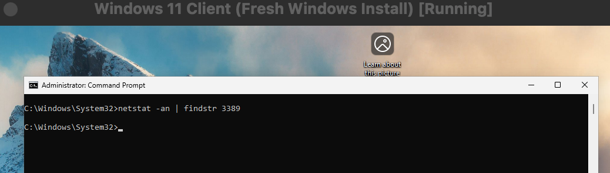


I also ran:

```cmd
qwinsta
```

No `rdp-tcp` listener was present.

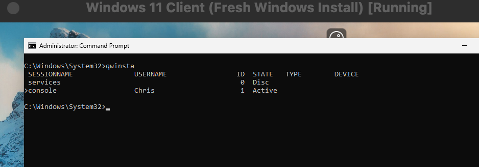


These results confirmed that the Windows client was not listening for incoming RDP connections.

### 4. Inspected Windows Firewall and Remote Desktop Settings

I checked Windows Defender Firewall and confirmed that the Remote Desktop inbound TCP and UDP rules were enabled and configured to allow connections.

I then opened **Settings > System > Remote Desktop**.

Remote Desktop was disabled, and Windows displayed:

> Some settings are managed by your organization.

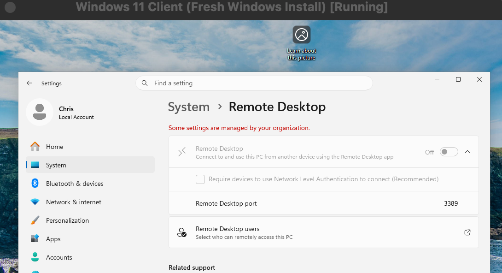


This suggested that a policy restriction might be preventing Remote Desktop from being enabled.

### 5. Identified the Restrictive Registry Policy

I inspected the Terminal Services policy registry key:

```cmd
reg query "HKLM\SOFTWARE\Policies\Microsoft\Windows NT\Terminal Services"
```

The results showed:

```text
fDenyTSConnections    REG_DWORD    0x1
```

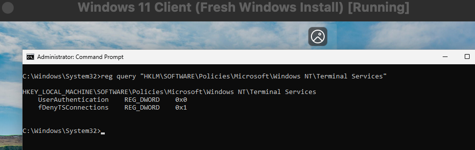


This confirmed that a policy was configured to deny incoming Remote Desktop connections.

Before changing the registry, I exported a backup of the Terminal Services policy key using `reg export`.

I then used `reg delete` to remove only the restrictive `fDenyTSConnections` policy value, leaving the other values in the key intact.


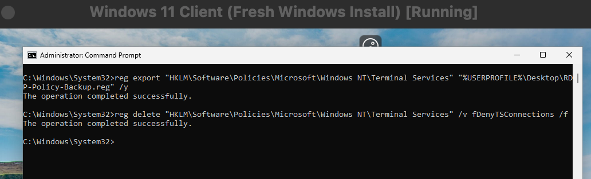


After removing the restriction:

- Remote Desktop was enabled in Windows Settings.
- The organization-managed restriction was no longer displayed.
- The local `fDenyTSConnections` value under `HKLM\SYSTEM\CurrentControlSet\Control\Terminal Server` was `0x0`.

 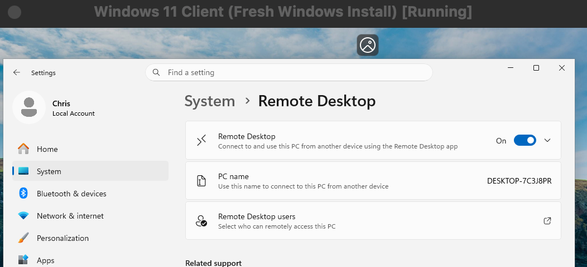

### 6. Checked Remote Desktop Services

I checked the status of Remote Desktop Services:

```cmd
sc query TermService
```

The service was stopped.

I also checked its startup configuration:

```cmd
sc qc TermService
```

The startup type was `DEMAND_START` (manual), rather than disabled.

I attempted to start the service:

```cmd
sc start TermService
```

The service initially entered `START_PENDING`, but this did not immediately restore a working RDP listener.

Further verification confirmed that `TermService` was eventually running.

### 7. Verified the Listener and Retested Remmina

I ran `qwinsta` again and confirmed that `rdp-tcp` appeared with a status of `Listen`.


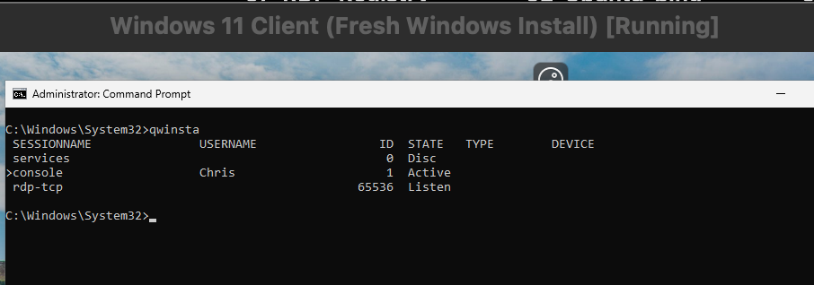


I then checked TCP port 3389:

```cmd
netstat -an | findstr 3389
```

The results showed that TCP port 3389 was listening on both IPv4 and IPv6:

```text
0.0.0.0:3389    LISTENING
[::]:3389       LISTENING
```

Finally, I retried the connection from Ubuntu using Remmina.

The connection succeeded, and I was able to access the Windows 11 desktop remotely.


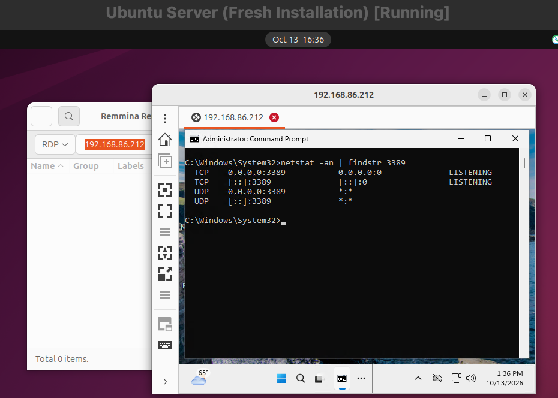


## Root Cause

The documented troubleshooting identified two conditions preventing RDP connectivity:

- A restrictive Terminal Services policy had `fDenyTSConnections` set to `0x1`, denying incoming Remote Desktop connections.
- Remote Desktop Services (`TermService`) was stopped, and no active RDP listener was present on TCP port 3389.

Together, these conditions prevented Remmina from connecting to the Windows 11 VM.

## Resolution

- Backed up the Terminal Services policy registry key.
- Removed the restrictive `fDenyTSConnections` policy value.
- Confirmed that Remote Desktop was enabled and the organization-managed restriction was gone.
- Started Remote Desktop Services and verified that it was running.
- Confirmed that the `rdp-tcp` listener and TCP port 3389 were active.

## Verification

The issue was considered resolved after confirming that:

- `TermService` was running.
- `qwinsta` displayed `rdp-tcp` in the `Listen` state.
- `netstat` showed TCP port 3389 in the `LISTENING` state.
- Remmina successfully connected from Ubuntu to Windows 11.
- The Windows desktop was accessible through the remote session.

## Prevention and Recommendations

- Review Remote Desktop policies when settings are unavailable or show organization-managed restrictions.
- Check `TermService` and the `rdp-tcp` listener when troubleshooting RDP failures.
- Verify that Windows Firewall permits authorized Remote Desktop traffic.
- Back up relevant registry keys before making changes.
- Restrict RDP access to authorized users and trusted networks. Avoid exposing TCP port 3389 directly to the public internet.


## Ticket Documentation

After troubleshooting the issue, I documented the findings, root cause, resolution, and verification in osTicket.

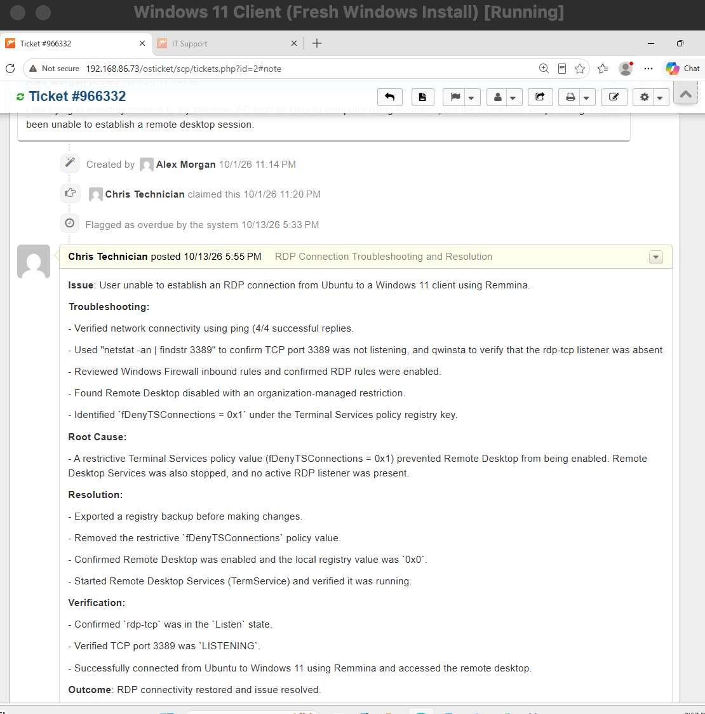


