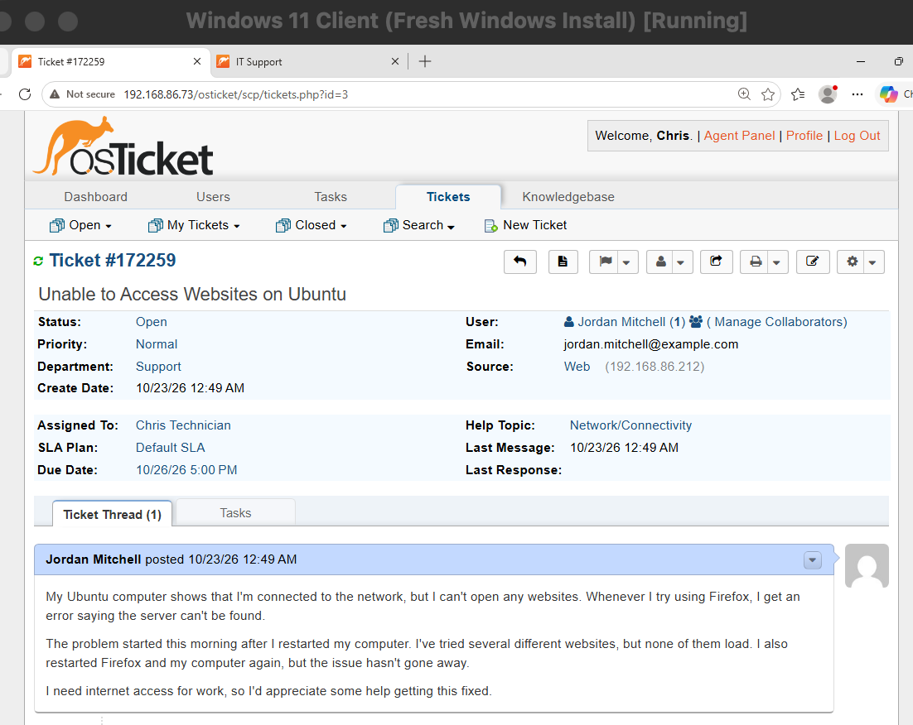
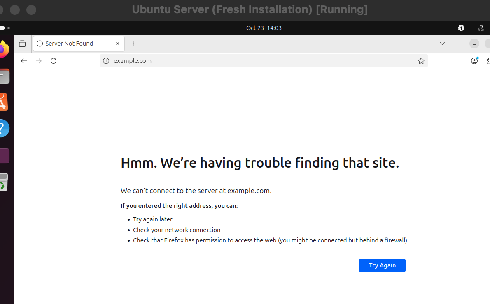
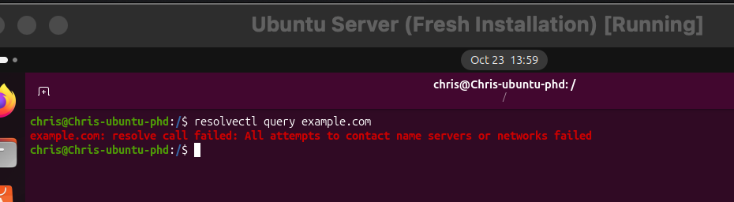
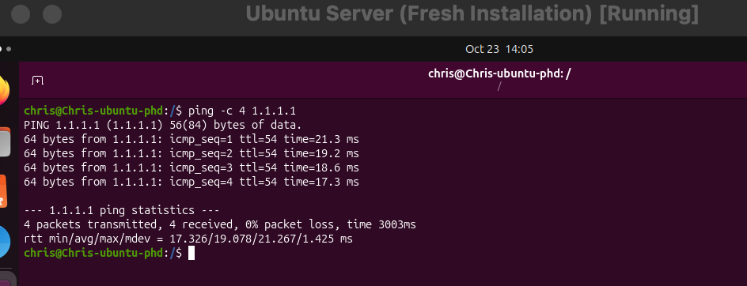
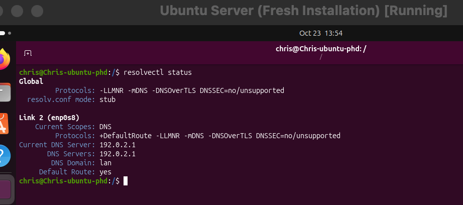
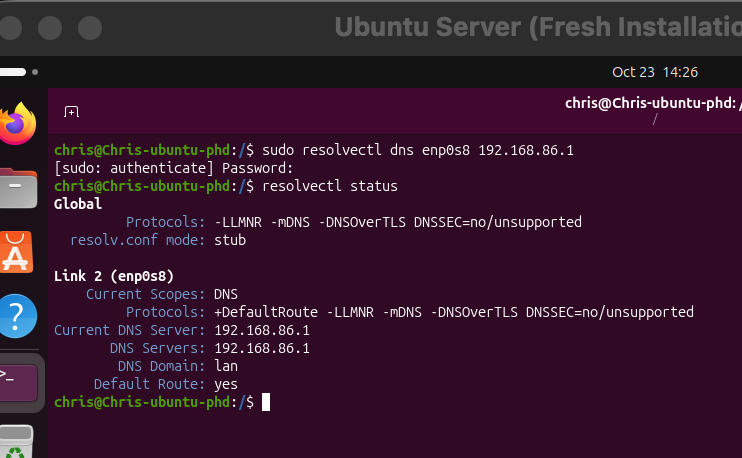
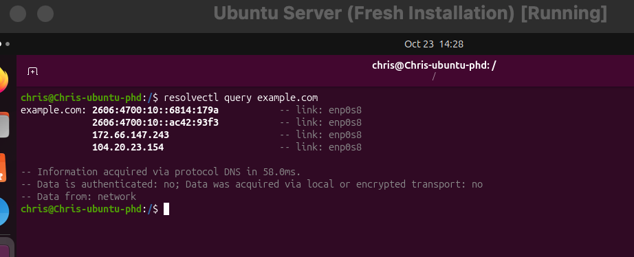
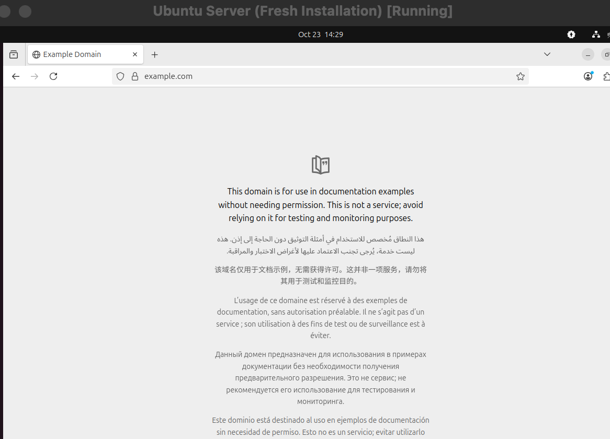
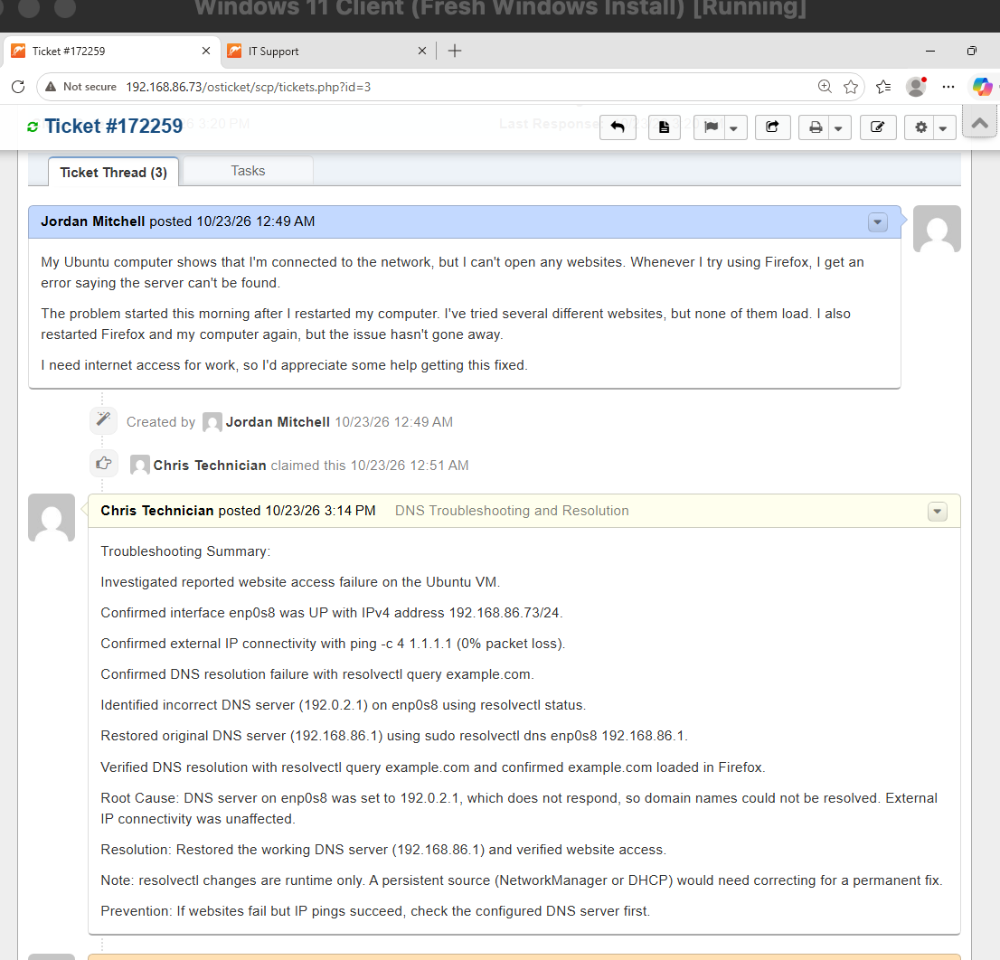
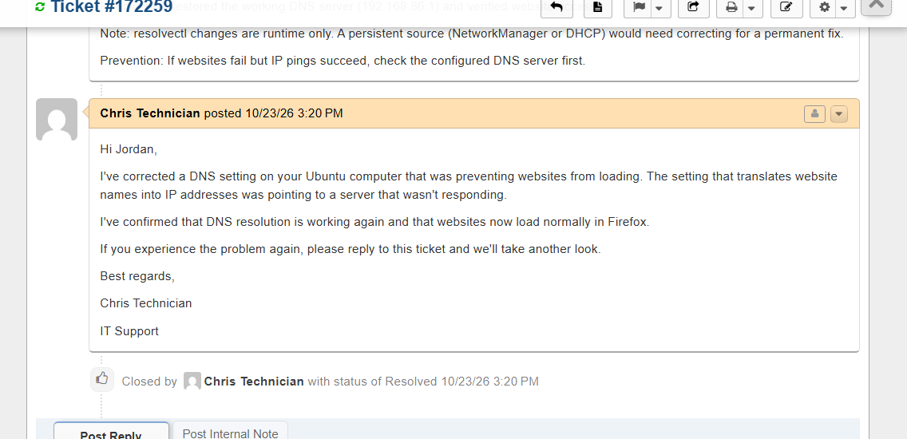

# Ticket 02 — Ubuntu DNS Resolution Failure

## Issue Description

A user reported that their Ubuntu computer appeared connected to the network but could not access websites. Firefox displayed a "Server Not Found" error when attempting to visit websites.

The user had already tried restarting Firefox and the computer, but the issue persisted.

The objective was to identify the cause of the website access failure, restore connectivity, and verify that DNS resolution was functioning correctly.


## Original Help Desk Ticket

The issue was documented in osTicket as ticket #172259, titled "Unable to Access Websites on Ubuntu."

The simulated user, Jordan Mitchell, reported that restarting Firefox and the computer had not resolved the problem.





## Lab Environment

| Component | Details |
|---|---|
| Operating System | Ubuntu 25.10 VM |
| Virtualization | Oracle VirtualBox |
| Web Browser | Mozilla Firefox |
| Network Interface | `enp0s8` |
| Original DNS Server | `192.168.86.1` |
| Ticketing System | osTicket |

**Simulation Setup:** To reproduce a DNS resolution failure in the lab, I intentionally changed the DNS server on interface `enp0s8` from `192.168.86.1` to `192.0.2.1` using `resolvectl`.


## Troubleshooting Steps

### 1. Reproduced the Reported Website Access Issue

I opened Firefox on the Ubuntu VM and attempted to access `example.com`.

Firefox displayed a "Server Not Found" error, confirming that the Ubuntu client could not access the website.

This reproduced the issue described in the original help desk ticket.





### 2. Tested DNS Resolution

I used `resolvectl` to determine whether Ubuntu could resolve domain names.

```bash
resolvectl query example.com
```

The DNS query failed, indicating that the system could not resolve the domain name.

This suggested that the website access issue could be related to DNS rather than the browser itself.





### 3. Verified External IP Connectivity

To determine whether the Ubuntu VM had general network connectivity, I tested communication with a public IP address.

```bash
ping -c 4 1.1.1.1
```

The results showed:

- 4 packets transmitted
- 4 packets received
- 0% packet loss

This confirmed that the Ubuntu VM could communicate with an external IP address even though domain-name resolution was failing.

The successful ping helped narrow the issue to DNS resolution rather than a complete network connectivity failure.





### 4. Checked the Network Interface

I checked the Ubuntu network interface using:

```bash
ip -br addr show enp0s8
```

The output confirmed that:

- Interface `enp0s8` was `UP`.
- The interface had the IPv4 address `192.168.86.73/24`.

This confirmed that the network interface was active and had an assigned IPv4 address.


### 5. Confirmed the DNS Configuration

I checked the system's DNS settings using:

```bash
resolvectl status
```

The output showed that network interface `enp0s8` was configured to use the following DNS server:

```text
192.0.2.1
```





This was not the original working DNS server.

Because the Ubuntu VM could reach an external IP address but could not resolve domain names, the incorrect DNS server configuration was identified as the cause of the issue.

### 6. Restored the Correct DNS Server

I restored the original working DNS server on interface `enp0s8`.

```bash
sudo resolvectl dns enp0s8 192.168.86.1
```

I then checked the DNS configuration again:

```bash
resolvectl status
```

The output confirmed that the DNS server had been restored to `192.168.86.1`.





### 7. Verified DNS Resolution

After restoring the correct DNS server, I tested domain-name resolution again.

```bash
resolvectl query example.com
```

The query completed successfully and returned IP addresses for the domain.





This confirmed that Ubuntu could resolve domain names again.

### 8. Verified Website Access in Firefox

I reopened Firefox and navigated to:

```text
https://example.com
```

The website loaded successfully without the previous DNS-related error.





This confirmed that website access had been restored.


## Root Cause

The Ubuntu VM was configured to use an incorrect DNS server (`192.0.2.1`) on network interface `enp0s8`.

As a result, Ubuntu could not resolve domain names into IP addresses, preventing Firefox from accessing websites.

Successful communication with `1.1.1.1` confirmed that external IP connectivity remained functional, helping isolate the issue to DNS resolution.

## Resolution

Restored the original working DNS server (`192.168.86.1`) on interface `enp0s8` using:

```bash
sudo resolvectl dns enp0s8 192.168.86.1
```

Confirmed that the correct DNS server was configured and that domain-name resolution and website access were functioning again.

## Verification

The following checks confirmed that the issue was resolved:

- `resolvectl status` displayed the restored DNS server (`192.168.86.1`).
- `resolvectl query example.com` successfully resolved the domain name.
- Firefox successfully loaded `https://example.com`.
- The original website access issue could no longer be reproduced.

## Prevention and Recommendations

- Verify DNS server settings when a computer has network connectivity but cannot access websites by domain name.
- Use `ping` with a known IP address to help distinguish general connectivity problems from DNS resolution failures.
- Use `resolvectl status` to inspect DNS settings and `resolvectl query` to test domain-name resolution.
- Ensure DNS server addresses are configured correctly through the system's network configuration.
- Verify website access after making DNS changes.

**Note:** Changes made using `resolvectl dns` may not persist after a network restart or system reboot. For a permanent correction, the appropriate persistent network configuration should also be checked and updated if necessary.


## Ticket Documentation

### Internal Note

After restoring DNS functionality, I documented the troubleshooting findings, root cause, resolution, and verification results in osTicket.



### User Reply and Ticket Closure

The ticket was marked resolved after confirming that DNS resolution and website access were restored.




