# Ticket 03 – Windows 11 Proxy Configuration Issue

## Issue Description

A user reported that their Windows 11 computer appeared connected to the network but could not access websites in Microsoft Edge. The browser displayed a "Hmmm... can't reach this page" error when attempting to open websites, including the company website.

The user stated that internet access had worked earlier in the day. Refreshing the page and restarting Microsoft Edge did not resolve the problem.

The objective was to identify why websites were inaccessible despite an active network connection, isolate the underlying cause, and restore normal browser functionality.

## Original Help Desk Ticket

The issue was documented in osTicket as ticket #589475, titled "Edge Can't Open any Websites on Windows 11."

The simulated user, Daniel Carter, reported that Microsoft Edge could not load websites even though Windows showed an active network connection.

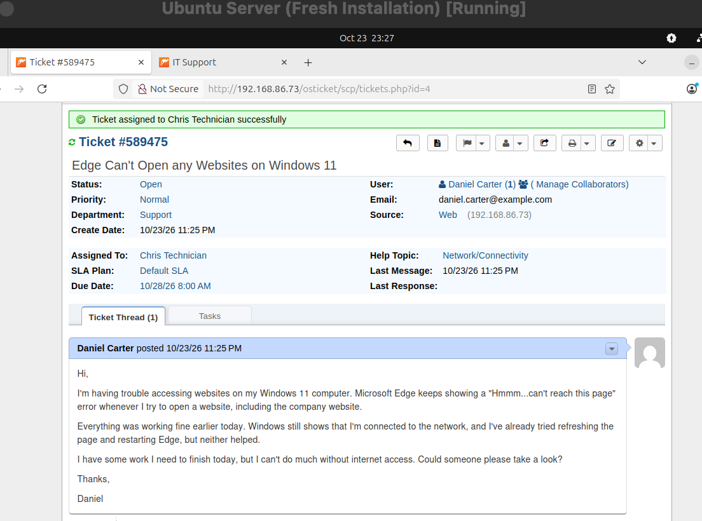

## Lab Environment

| Component | Details |
|---|---|
| Operating System | Windows 11 Client VM |
| Virtualization | Oracle VirtualBox |
| Web Browser | Microsoft Edge |
| Diagnostic Tools | Windows Command Prompt |
| Ticketing System | osTicket |

**Simulation Setup:** To reproduce a website access failure in the lab, I intentionally enabled the Windows 11 manual proxy configuration and set the proxy server to `192.0.2.1` on port `8080`.

The address `192.0.2.1` belongs to an IP range reserved for documentation and was used to simulate an unreachable proxy server.

Before introducing the issue, Microsoft Edge could access websites and the manual proxy setting was disabled.

## Troubleshooting Steps

### 1. Reproduced the Reported Website Access Issue

I opened Microsoft Edge on the Windows 11 VM and attempted to access:

```text
https://example.com
```

Microsoft Edge displayed a "Hmmm... can't reach this page" error.

This reproduced the website access issue described in the original help desk ticket.

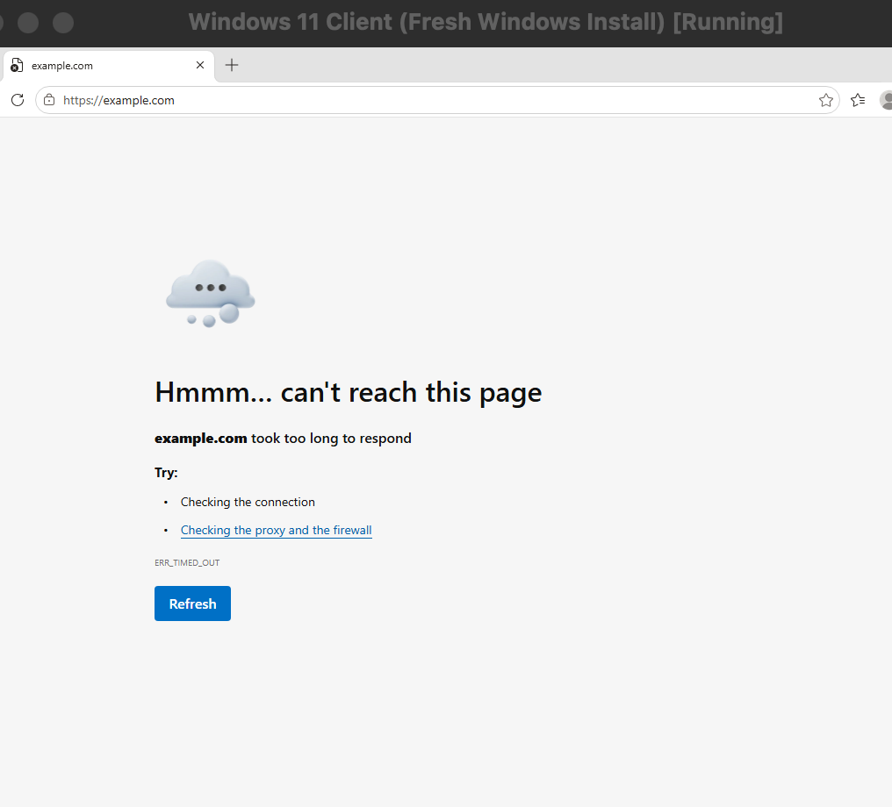

### 2. Checked the Windows IP Configuration

I opened Command Prompt and inspected the network configuration using:

```cmd
ipconfig /all
```

The output confirmed the following settings:

| Setting | Value |
|---|---|
| IPv4 Address | `192.168.86.212` |
| Default Gateway | `192.168.86.1` |
| DNS Server | `192.168.86.1` |
| DHCP | Enabled |

The Windows 11 VM had an assigned IP address, a default gateway, and a configured DNS server.

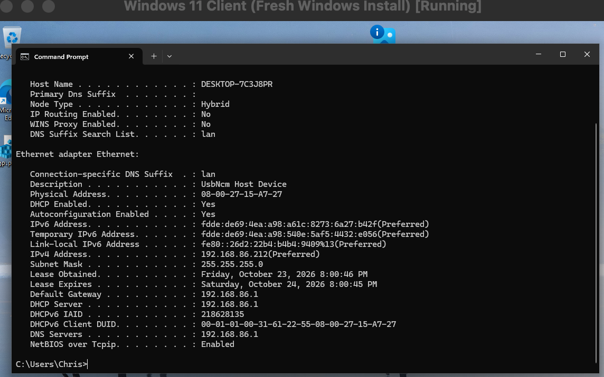

### 3. Tested Default Gateway Connectivity

I tested communication with the default gateway:

```cmd
ping 192.168.86.1
```

The test returned:

- 4 packets sent
- 4 packets received
- 0% packet loss

This confirmed that the Windows 11 VM could communicate with its local network gateway.

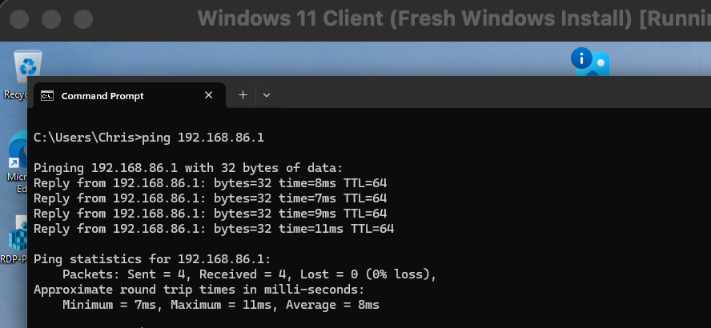

### 4. Tested External IP Connectivity

Next, I tested connectivity to an external IP address:

```cmd
ping 1.1.1.1
```

The test returned:

- 4 packets sent
- 4 packets received
- 0% packet loss

This confirmed that the Windows 11 VM could communicate with an external IP address.

Because external IP connectivity worked while Microsoft Edge could not load websites, the issue was not a complete network connectivity failure.

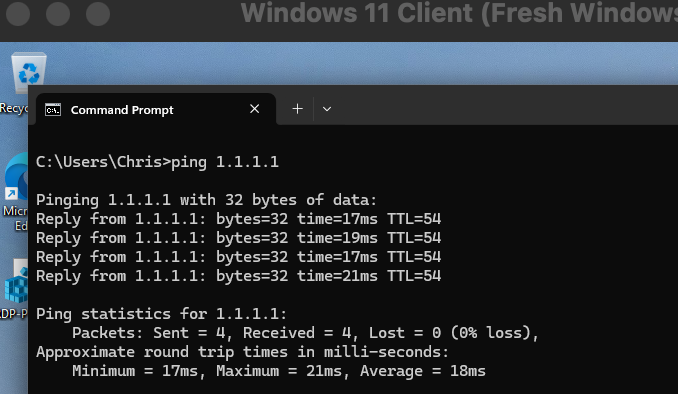

### 5. Tested DNS Resolution

I checked whether Windows could resolve domain names using:

```cmd
nslookup example.com
```

The query completed successfully and returned IPv4 and IPv6 addresses for the domain.

This confirmed that DNS resolution was functioning.

Since the default gateway, external IP connectivity, and DNS resolution tests were successful, I investigated the Windows proxy configuration as a possible cause of the browser failure.

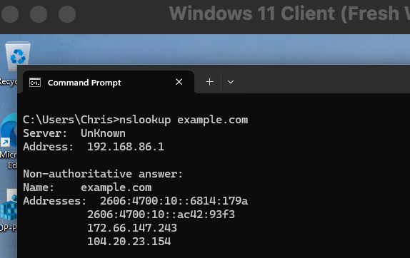

### 6. Identified the Incorrect Proxy Configuration

I navigated to:

**Settings → Network & internet → Proxy → Manual proxy setup**

I discovered that **Use a proxy server** was enabled.

The manual proxy was configured with the following settings:

| Setting | Value |
|---|---|
| Proxy Server | `192.0.2.1` |
| Port | `8080` |

The configured proxy server was intentionally unreachable.

Because Microsoft Edge was attempting to use this proxy, it could not establish normal website connections despite the computer having working IP connectivity and DNS resolution.

This identified the incorrect manual proxy configuration as the root cause.

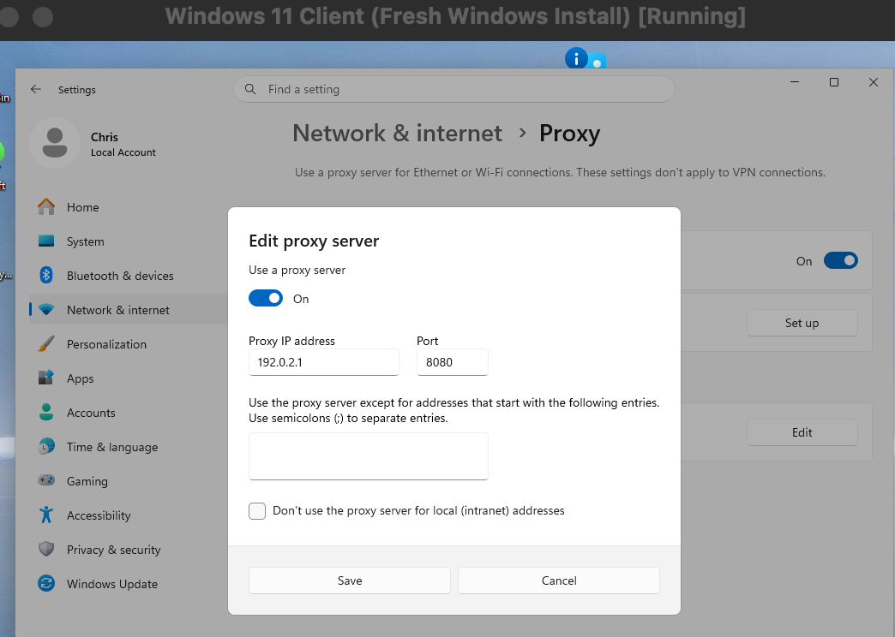

### 7. Restored the Original Proxy Configuration

I returned to:

**Settings → Network & internet → Proxy → Manual proxy setup**

I changed **Use a proxy server** from **On** to **Off** and saved the corrected settings.

This restored the original Windows proxy configuration.

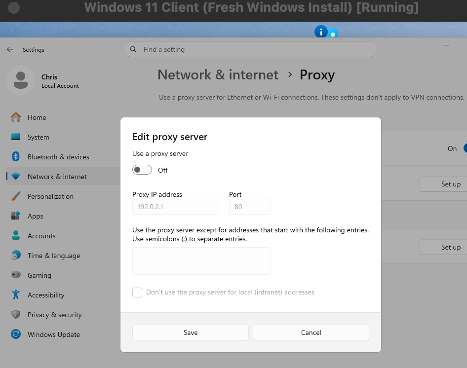

### 8. Verified Website Access in Microsoft Edge

After disabling the incorrect proxy, I reopened Microsoft Edge and navigated to:

```text
https://example.com
```

The website loaded successfully without the previous connection error.

This confirmed that disabling the incorrect manual proxy restored browser access.

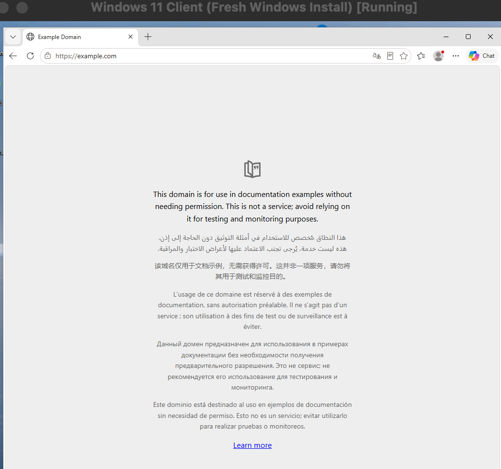

## Root Cause

The Windows 11 VM was configured to use an incorrect manual proxy server:

- **Proxy address:** `192.0.2.1`
- **Port:** `8080`

The configured proxy server was unreachable, preventing Microsoft Edge from establishing website connections.

Network connectivity and DNS resolution remained functional, as demonstrated by successful gateway and external IP ping tests and a successful `nslookup` query.

The issue was therefore caused by the manual proxy configuration rather than a general network or DNS failure.


## Resolution

I disabled the incorrect manual proxy configuration through Windows Settings.

The **Use a proxy server** setting was changed from **On** to **Off**, restoring the original configuration.

After the change, Microsoft Edge successfully loaded `https://example.com`, confirming that normal website access had been restored.

## Verification

The following checks confirmed that the issue was resolved:

- The manual proxy setting was disabled.
- Windows retained its working IP configuration.
- The default gateway was reachable.
- External IP connectivity was functional.
- DNS resolution was successful.
- Microsoft Edge successfully loaded `https://example.com`.
- The original website access error could no longer be reproduced.

## Prevention and Recommendations

- Check Windows proxy settings when websites fail to load despite successful network connectivity and DNS tests.
- Avoid enabling manual proxy settings unless required by the organization's network configuration.
- If a proxy server is required, verify that its address and port are correct and that the server is reachable.
- Use `ipconfig /all`, `ping`, and `nslookup` to distinguish network connectivity and DNS failures from proxy-related issues.
- Verify browser access after making proxy configuration changes.

## Ticket Documentation

After restoring website access, I documented the troubleshooting findings, root cause, resolution, and verification results in osTicket.

The ticket included an internal troubleshooting note and a response explaining the resolution to the simulated end user.

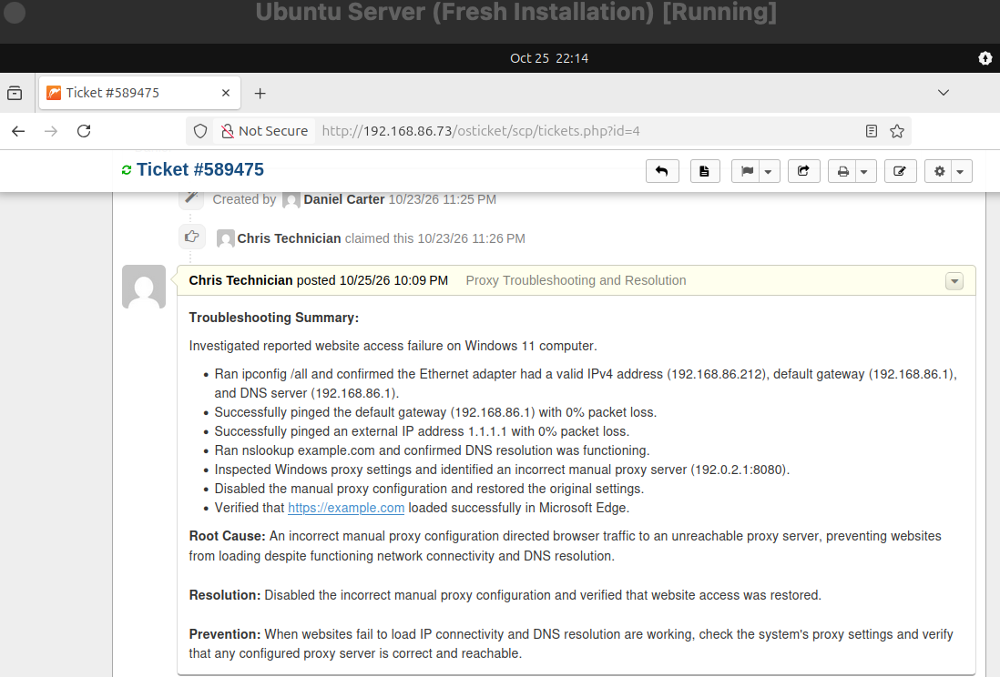

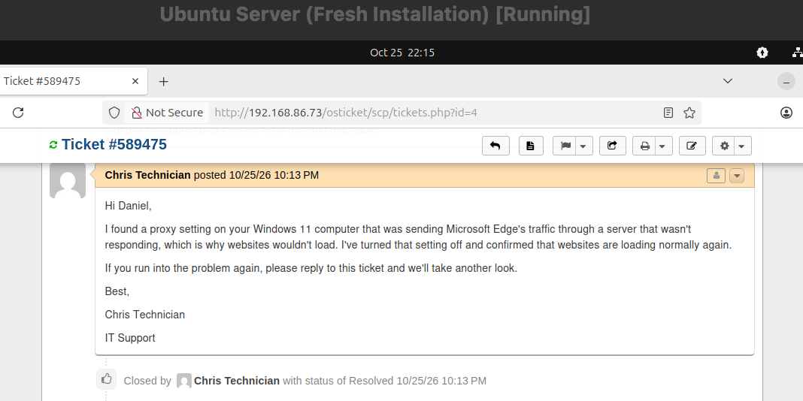

