# Ticket 04 — Windows 11 NTFS Permissions Issue

## Issue Description

A standard user, Dinesh, reported that he could no longer access the `C:\CompanyDocuments` folder on his Windows 11 computer, despite previously having access.

When attempting to open the folder, Windows displayed a permissions warning preventing him from accessing its contents.

The objective was to identify the cause of the access restriction, restore the appropriate NTFS permissions, and verify that Dinesh could access the required folder and document without receiving unnecessary modification privileges.


## Original Help Desk Ticket

The issue was documented in osTicket after Dinesh reported being unable to access the `C:\CompanyDocuments` folder on his Windows 11 computer.

The user previously had access to the folder but began receiving a permissions warning when attempting to open it.

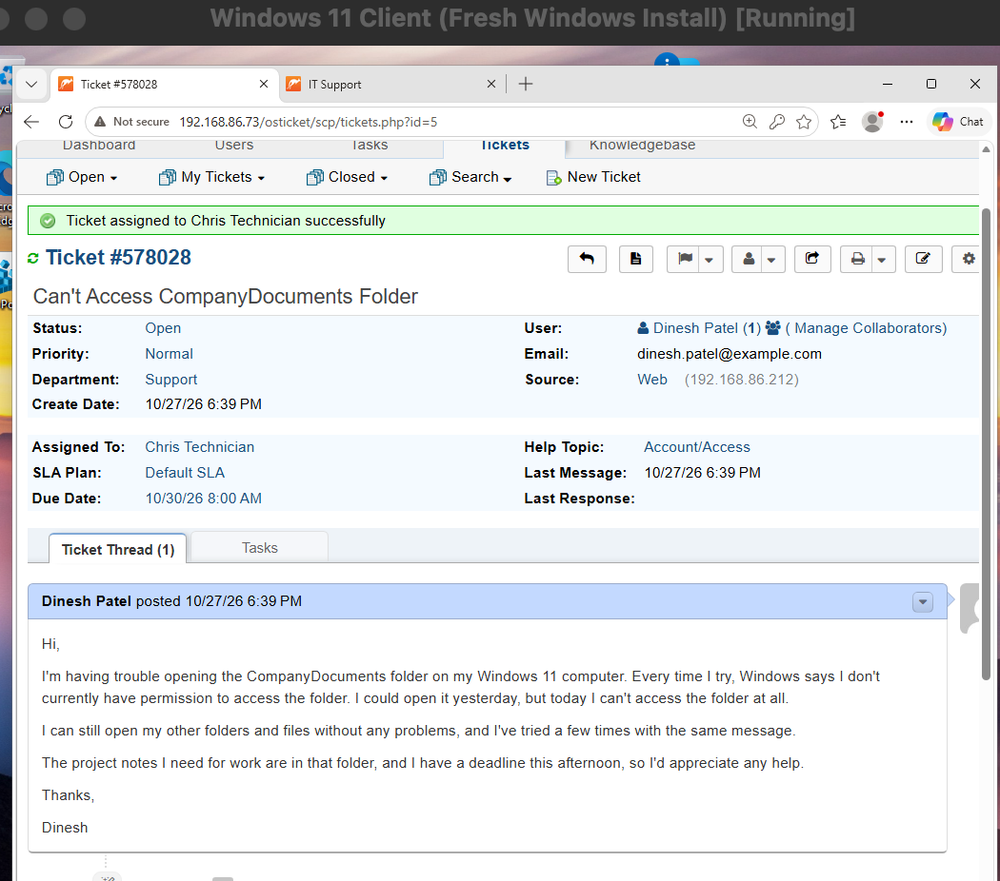


## Lab Environment

| Component | Details |
|---|---|
| Operating System | Windows 11 Client VM |
| Virtualization | Oracle VirtualBox |
| Ticketing System | osTicket |
| Administrator Account | Chris |
| Standard User Account | Dinesh |
| Folder | `C:\CompanyDocuments` |
| Document | `ProjectNotes.txt` |

**Simulation Setup:** To reproduce an NTFS permissions issue, I created the `C:\CompanyDocuments` folder and a file named `ProjectNotes.txt`.

I verified that Dinesh could access both before disabling NTFS permission inheritance on the folder and removing the Users and Authenticated Users permission entries. This left Administrators and SYSTEM with Full Control and prevented Dinesh from accessing the folder.


## Troubleshooting Steps

### 1. Reproduced the Folder Access Issue

Signed in to the Windows 11 Client VM using the Dinesh standard user account.

Attempted to open `C:\CompanyDocuments` and confirmed that Windows displayed a permissions warning, preventing access to the folder.

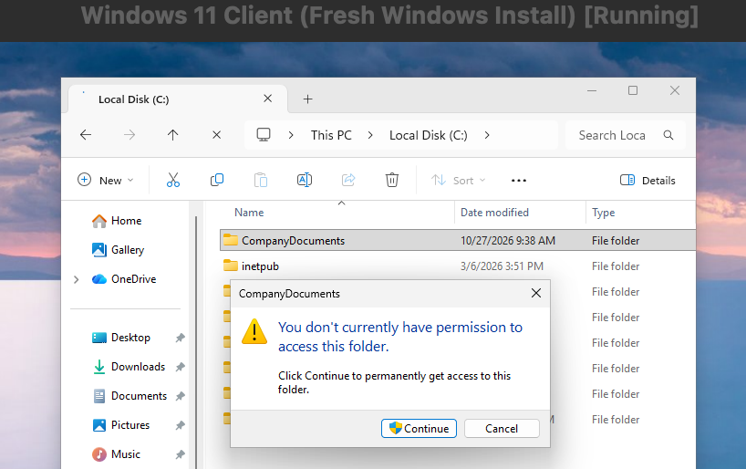

### 2. Inspected the Folder's NTFS Permissions

Signed in using the Chris administrator account and opened the Security and Advanced Security Settings for `C:\CompanyDocuments`.

Confirmed that NTFS permission inheritance was disabled and that only Administrators and SYSTEM had Full Control.

No permission entry was present for Dinesh or the Users group.

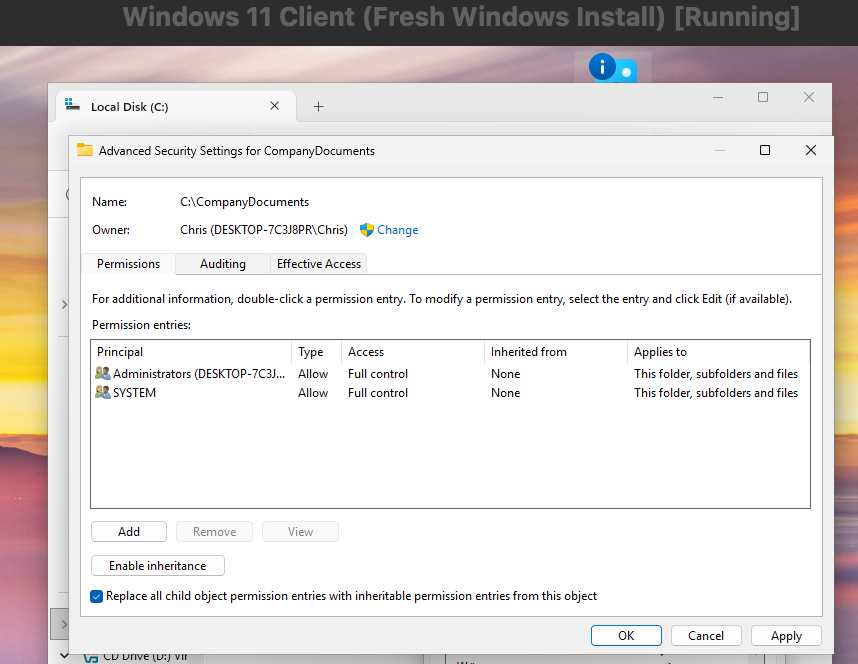

### 3. Checked the User's Effective Access

Used the Effective Access tab in Advanced Security Settings to evaluate Dinesh's permissions on `C:\CompanyDocuments`.

Confirmed that Dinesh lacked the effective permissions required to list the folder's contents or read its files.

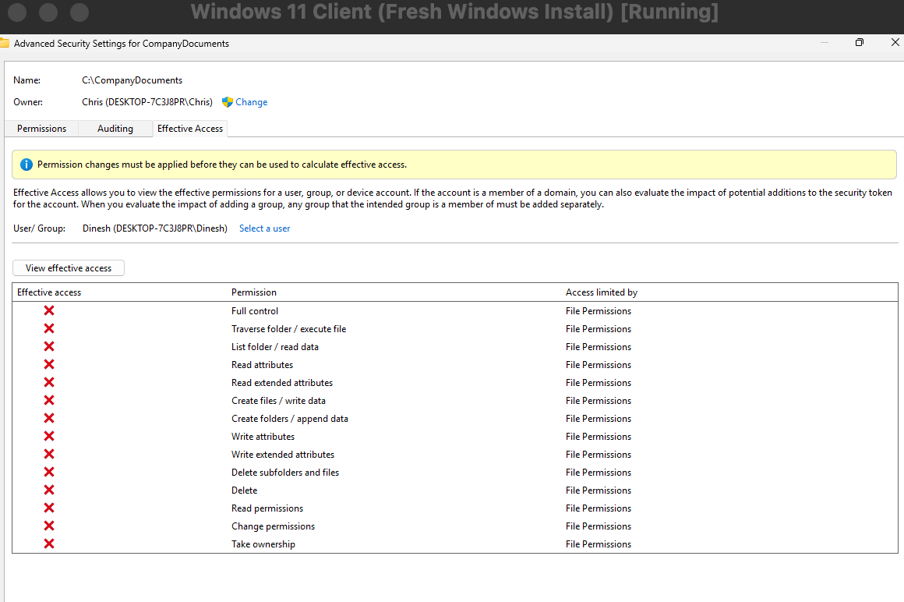


### 4. Attempted to Restore Folder Permissions

Attempted to restore the appropriate NTFS permissions on `C:\CompanyDocuments` through Advanced Security Settings.

During the process, Windows displayed an **Error Applying Security** message:

`Failed to enumerate objects in the container. Access is denied.`

This indicated that the permission changes could not be successfully applied to all objects within the folder.

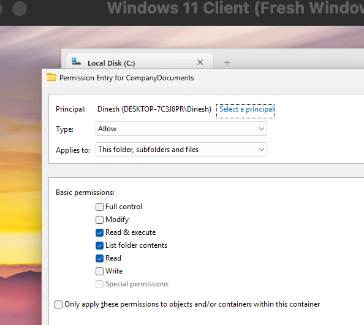

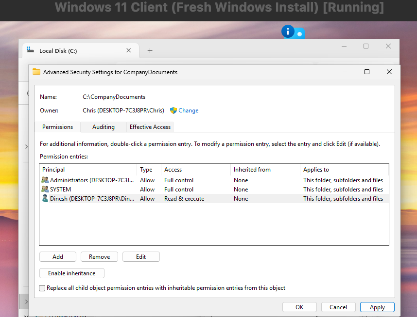

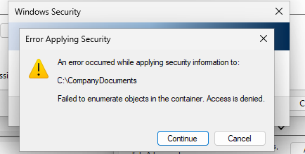

### 5. Identified a Remaining File Access Issue

Signed back in using the Dinesh standard user account to test the updated permissions.

Confirmed that Dinesh could now open `C:\CompanyDocuments`, but attempting to open `ProjectNotes.txt` still resulted in an access-denied error.

This indicated that the folder permissions had been partially restored, but a separate file-level permissions issue remained.

### 6. Inspected Folder Permissions Using Command Prompt

Returned to the Chris administrator account and opened an elevated Command Prompt.

Ran the following command to inspect the folder's NTFS permissions:

`icacls "C:\CompanyDocuments"`

Confirmed that Dinesh had Read & Execute (RX) permissions on the parent folder.

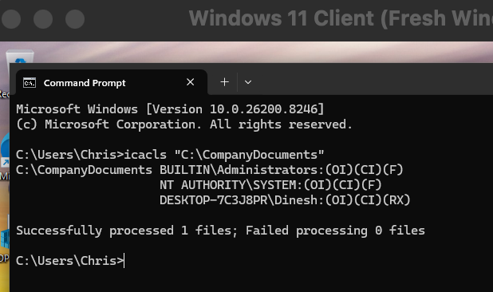

### 7. Inspected File-Level Permissions

Ran the following command to inspect the permissions on the affected document:

`icacls "C:\CompanyDocuments\ProjectNotes.txt"`

Confirmed that the file contained permission entries for Administrators and SYSTEM but did not grant Dinesh access.

Determined that file-level permission inheritance was disabled, preventing `ProjectNotes.txt` from inheriting Dinesh's permissions from the parent folder.

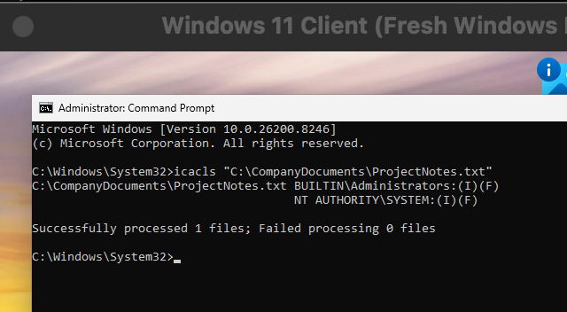


### 8. Restored File-Level NTFS Permission Inheritance

Using the elevated Command Prompt under the Chris administrator account, restored NTFS permission inheritance on `ProjectNotes.txt` with the following command:

```cmd
icacls "C:\CompanyDocuments\ProjectNotes.txt" /inheritance:e
```

The command completed successfully, allowing the document to inherit permissions from its parent folder.

Ran the following command to verify the updated file permissions:

```cmd
icacls "C:\CompanyDocuments\ProjectNotes.txt"
```

Confirmed that `ProjectNotes.txt` now inherited Dinesh's Read & Execute (RX) permissions from `C:\CompanyDocuments`.

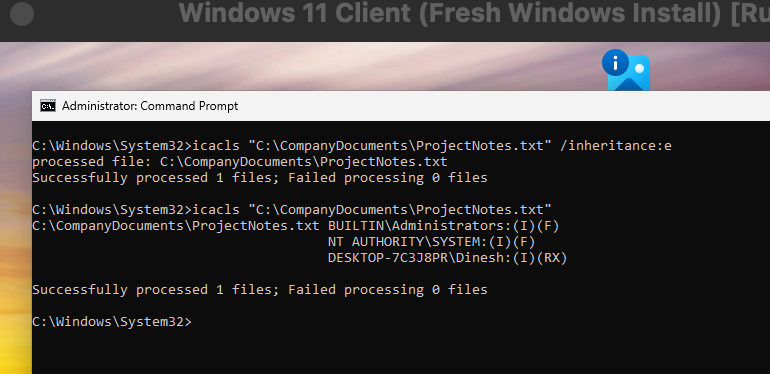

### 9. Verified Document Access and Permission Restrictions

Signed back in using the Dinesh standard user account.

Successfully opened `C:\CompanyDocuments` without receiving a permissions warning.

Opened `ProjectNotes.txt` in Notepad and confirmed that the document could be read successfully.

Attempted to modify and save the document and confirmed that Windows prevented the changes from being saved due to insufficient permissions.

This verified that Dinesh had the required read access without unnecessary write or modification privileges.

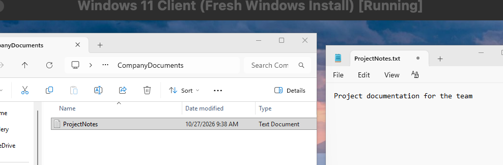


## Root Cause

The initial folder access issue was caused by incorrectly configured NTFS permissions on `C:\CompanyDocuments`.

NTFS permission inheritance had been disabled, and the Users and Authenticated Users permission entries had been removed, leaving only Administrators and SYSTEM with Full Control.

As a result, Dinesh lacked the permissions required to access the folder, list its contents, or read its files. This was confirmed using the Effective Access tab in Advanced Security Settings.

A separate file-level permissions issue remained after folder access was restored.

Although Dinesh had Read & Execute (RX) permissions on `C:\CompanyDocuments`, the `ProjectNotes.txt` file had inheritance disabled and did not contain a permission entry granting Dinesh access.

This meant that Dinesh could open the parent folder but could not read the document until file-level permission inheritance was restored.


## Resolution

Restored the appropriate NTFS permissions on `C:\CompanyDocuments`, granting Dinesh Read & Execute (RX) access without unnecessary modification privileges.

After identifying that `ProjectNotes.txt` was not inheriting permissions from its parent folder, opened an elevated Command Prompt using the Chris administrator account.

Restored file-level NTFS permission inheritance using the following command:

```cmd
icacls "C:\CompanyDocuments\ProjectNotes.txt" /inheritance:e
```

The command completed successfully.

Ran `icacls` again to confirm that `ProjectNotes.txt` inherited Dinesh's Read & Execute (RX) permissions from the parent folder.

Both the folder and document were accessible to Dinesh while maintaining read-only permissions.


## Verification

Signed in to the Windows 11 Client VM using the Dinesh standard user account to verify that the NTFS permission changes resolved the issue.

- Successfully opened `C:\CompanyDocuments` without receiving a permissions warning.
- Opened `ProjectNotes.txt` in Notepad and confirmed that the document could be read successfully.
- Attempted to modify and save `ProjectNotes.txt` and confirmed that the changes could not be saved due to insufficient permissions.
- Used `icacls` to verify that the document inherited Dinesh's Read & Execute (RX) permissions from the parent folder.

Confirmed that Dinesh could access the required folder and document without being granted unnecessary write or modification permissions.


## Prevention and Recommendations

- Follow the principle of least privilege by granting users only the NTFS permissions required to perform their tasks.
- Assign NTFS permissions to security groups rather than individual users when possible to simplify access management.
- Use NTFS permission inheritance where appropriate to maintain consistent permissions between parent folders and their files.
- Review existing permissions and inheritance settings before making changes to avoid accidentally removing user access.
- Use the Effective Access tab and `icacls` to investigate and verify NTFS permissions.
- Test both folder-level and file-level access after modifying permissions to confirm that the changes worked correctly.
- Obtain approval from the folder owner or responsible manager before granting additional write or modification permissions.

## Ticket Documentation


Documented the troubleshooting process in osTicket, including the initial folder access issue, the incorrect NTFS permissions, and the additional file-level inheritance problem.

Recorded the steps taken to restore the appropriate permissions and verify that Dinesh could access the folder and document.

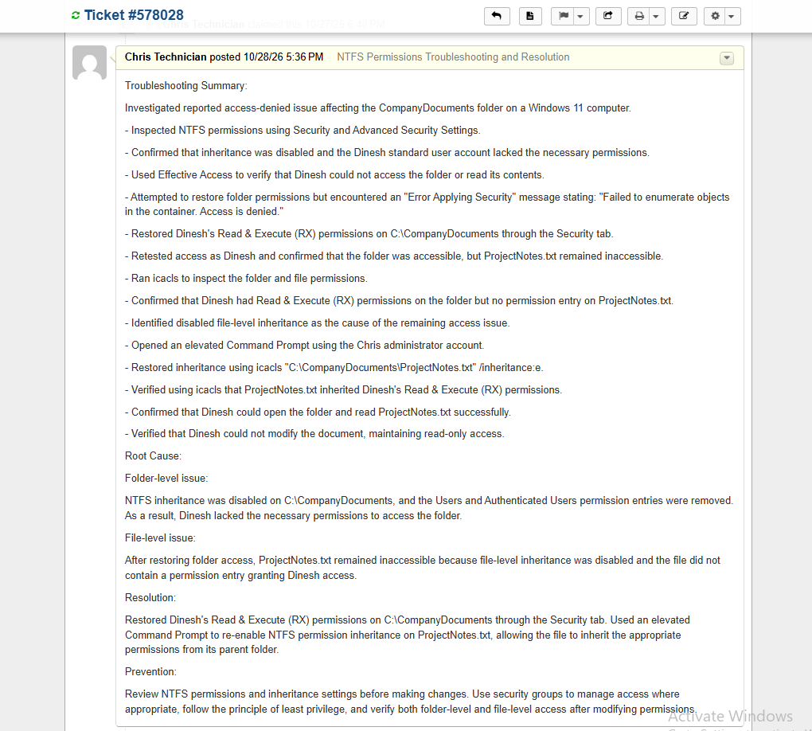


Replied to the user through osTicket to communicate that the permissions issue had been resolved.

Documented that access to `C:\CompanyDocuments` and `ProjectNotes.txt` was restored while maintaining read-only permissions.

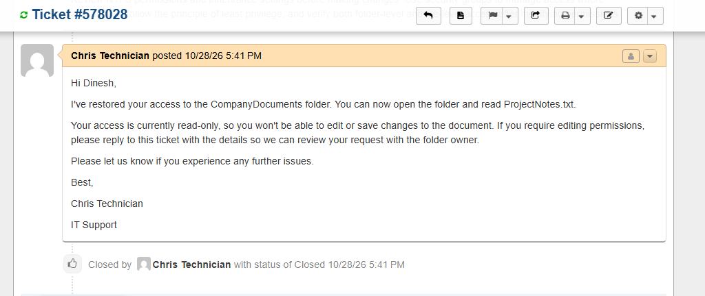


