# Ticket 05 — Windows 11 Network Connectivity Failure

## Issue Description

A user, Ryan Foster, reported that his Windows 11 computer could no longer access the internet despite appearing to be connected to the network.

External websites and internet services were inaccessible, and restarting the computer did not resolve the issue.

The objective was to identify why internet connectivity was failing despite an active network connection, restore the appropriate network configuration, and verify that external connectivity and website access were working correctly.


## Original Help Desk Ticket

The issue was documented in osTicket as Ticket #135065 after Ryan Foster reported that his Windows 11 computer could not access the internet.

Although the computer appeared connected to the network, external websites and internet services were inaccessible. Restarting the computer did not resolve the issue.

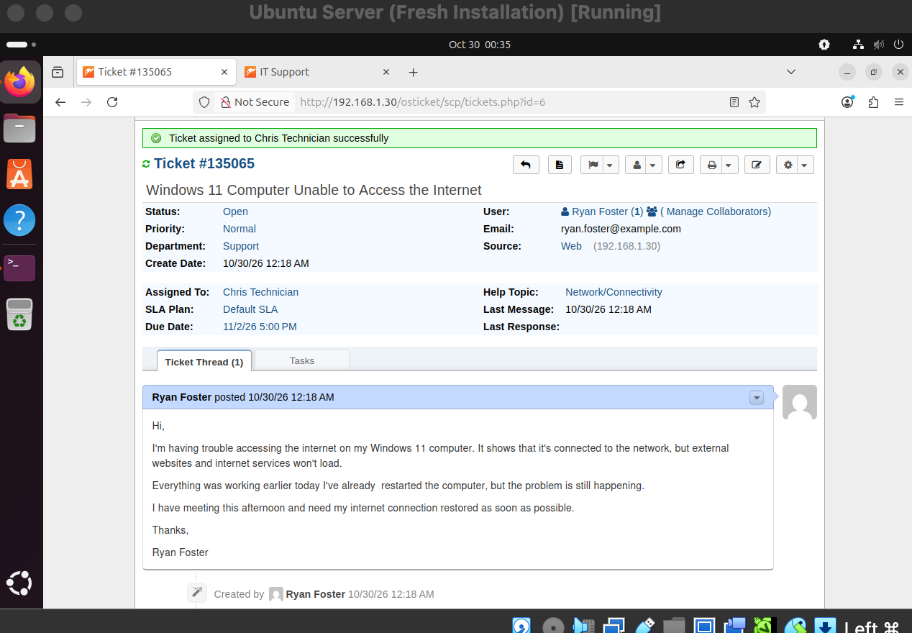


## Lab Environment

| Component | Details |
|---|---|
| Operating System | Windows 11 |
| Virtualization | Oracle VirtualBox |
| Affected System | Windows 11 Client VM |
| Ticketing System | osTicket |
| Network Adapter | Ethernet (UsbNcm Host Device) |
| Network Mode | Bridged Adapter |
| Network Configuration | Static IPv4 (Before Fix), DHCP (After Fix) |
| Troubleshooting Tools | Command Prompt, `ipconfig`, `ping`, `route print`, `tracert`, `nslookup`, Windows Network Settings, Microsoft Edge |


**Simulation Setup:** To reproduce the network connectivity issue, I manually configured the Windows 11 Client VM with a static IPv4 address of `192.168.1.18`, subnet mask `255.255.255.0`, and an intentionally incorrect default gateway of `192.168.1.254`.

The preferred and alternate DNS servers were configured as `167.206.13.180` and `167.206.13.181`.

The correct gateway on the original network was `192.168.1.1`. Using an incorrect default gateway allowed local network communication to continue while preventing external IPv4 connectivity.


## Troubleshooting Steps


### Initial Network Status

Opened Windows Settings and navigated to **Network & internet**.

Confirmed that Ethernet was detected, but Windows reported "No internet access" and indicated that only local network devices were accessible.

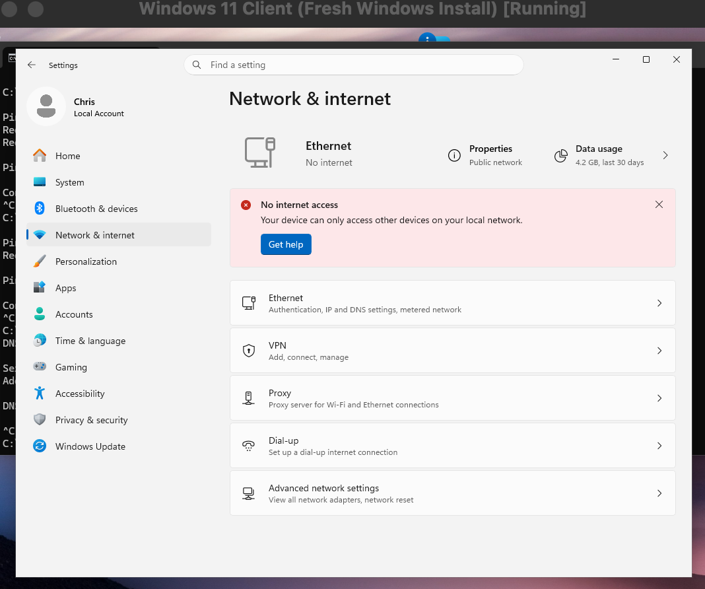


### 1. Checked IPv4 Configuration

Opened Command Prompt on the Windows 11 Client VM and ran:

```cmd
ipconfig /all
```

Confirmed that the Ethernet adapter was configured with a static IPv4 address of `192.168.1.18` and subnet mask of `255.255.255.0`.

The configured default gateway was `192.168.1.254`, with DNS servers `167.206.13.180` and `167.206.13.181`.

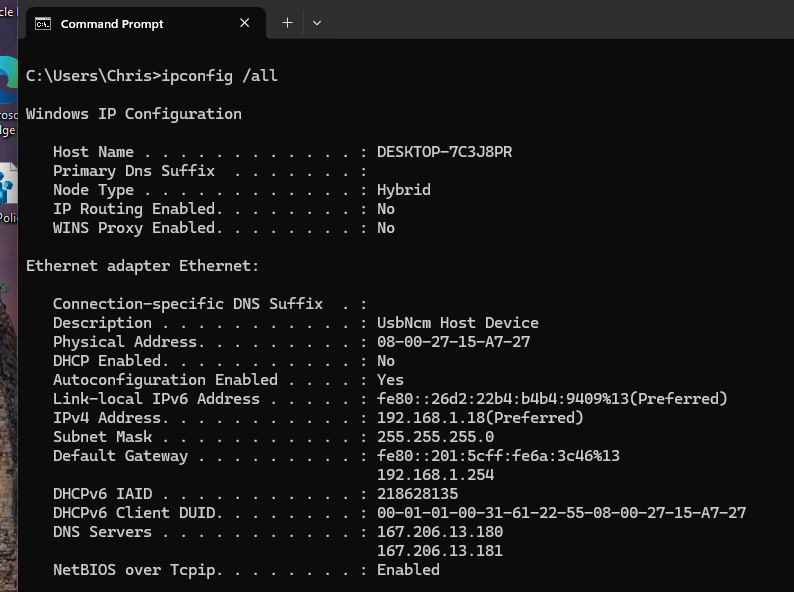


### 2. Tested Connectivity to the Local Router

Ran the following command to test connectivity to `192.168.1.1`, which had previously been identified as the router on the original network:

```cmd
ping -4 192.168.1.1
```

Received four successful replies with 0% packet loss.

This confirmed that the Windows VM could communicate with the router on the local subnet without relying on its configured default gateway.

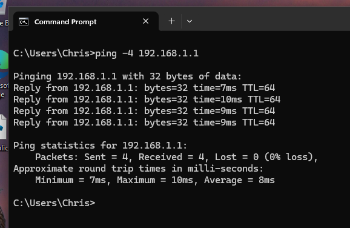


### 3. Tested Connectivity to the Configured Gateway

Ran the following command:

```cmd
ping -4 192.168.1.254
```

All four requests failed, resulting in 100% packet loss.

The configured gateway did not respond to ICMP echo requests.

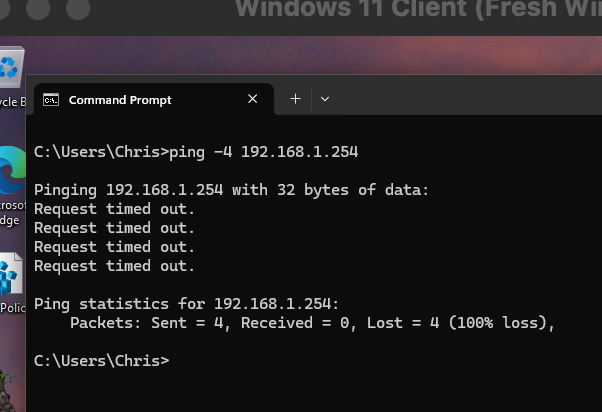


### 4. Tested External IPv4 Connectivity

Ran the following command to test connectivity to an external IP address:

```cmd
ping -4 1.1.1.1
```

Three requests timed out, and one returned `Destination host unreachable` from `192.168.1.18`.

No successful replies were received.

This confirmed that external IPv4 connectivity was failing despite successful communication with the local router.

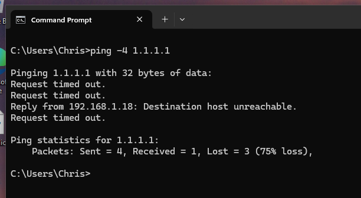

### 5. Examined the IPv4 Routing Table

Ran the following command to inspect the Windows routing table:

```cmd
route print -4
```

Identified a default route (`0.0.0.0/0`) pointing to `192.168.1.254` through the `192.168.1.18` interface.

This confirmed that Windows was configured to send traffic destined for external IPv4 networks through `192.168.1.254`.

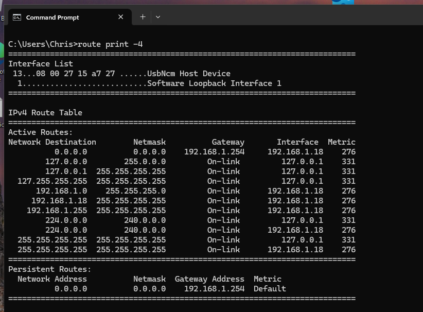

### 6. Traced the Route to an External IP Address

Ran the following command:

```cmd
tracert -4 -d 1.1.1.1
```

The command returned:

`192.168.1.18 reports: Destination host unreachable.`

The response originated from the Windows VM itself, indicating that the trace failed before reaching a responding router.

This was consistent with the routing table findings and suggested that Windows could not successfully forward traffic through its configured default gateway.

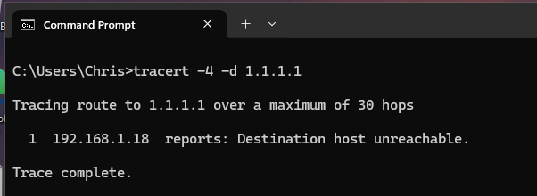


### 7. Tested DNS Resolution

Ran the following command to check whether the Windows VM could resolve domain names:

```cmd
nslookup example.com
```

The command returned multiple DNS request timeouts without resolving the domain to an IP address.

The configured DNS servers were outside the local subnet and could not be reached through the incorrect default gateway.

This indicated that DNS resolution was also affected by the network connectivity issue.

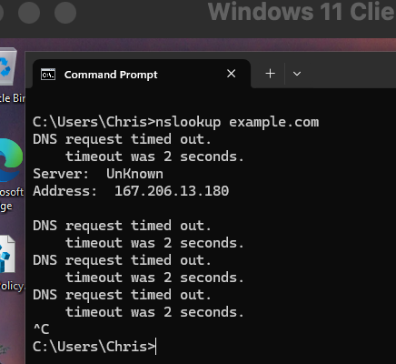

### 8. Reviewed IPv4 Adapter Settings

Opened the Ethernet adapter's Properties and navigated to Internet Protocol Version 4 (TCP/IPv4) Properties.

Confirmed that the adapter was using a manually configured static IPv4 address.

The default gateway was set to `192.168.1.254`, rather than `192.168.1.1`, which had previously been identified as the router on the original network.

The incorrect gateway configuration was consistent with the failed external connectivity tests and routing table findings.

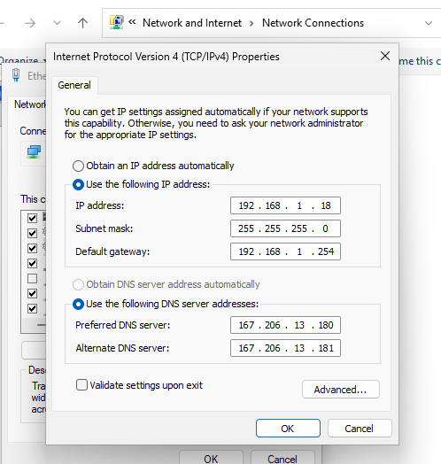


### 9. Restored Automatic IPv4 Configuration

Opened the Ethernet adapter's Properties and navigated to Internet Protocol Version 4 (TCP/IPv4) Properties.

Changed the network configuration to:

- **Obtain an IP address automatically**
- **Obtain DNS server address automatically**

Applied the changes to allow Windows to receive its network configuration through DHCP instead of using the incorrect static settings.

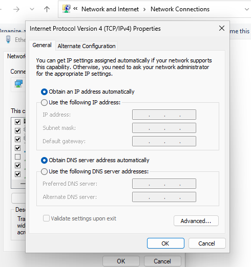

### 10. Verified Updated Network Configuration

Opened Command Prompt and ran:

```cmd
ipconfig /all
```

Confirmed that DHCP was enabled and Windows had received the following network settings:

- **IPv4 Address:** `192.168.86.212`
- **Subnet Mask:** `255.255.255.0`
- **Default Gateway:** `192.168.86.1`

Between troubleshooting sessions, the Mac host was found connected to a different Wi-Fi network. Because the Windows VM used bridged networking, it received an IP address on a different subnet after restoring DHCP.

The exact time and reason for the Wi-Fi network change were not confirmed.

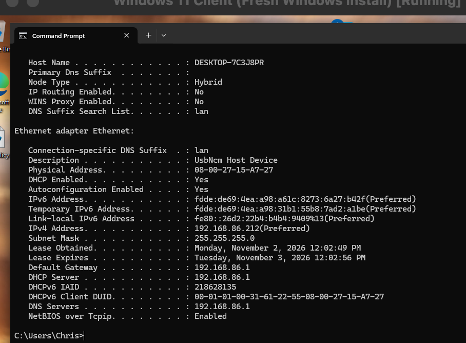


### 11. Retested External IPv4 Connectivity

Opened Command Prompt and ran the following command:

```cmd
ping -4 1.1.1.1
```

Received four successful replies with 0% packet loss.

This confirmed that external IPv4 connectivity was restored after switching to DHCP.

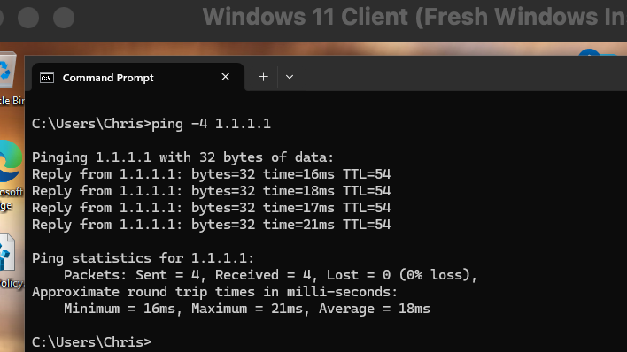

### 12. Retested DNS Resolution

Ran the following command:

```cmd
nslookup example.com
```

Successfully resolved `example.com` using DNS server `192.168.86.1`.

This confirmed that DNS resolution was functioning after restoring automatic network configuration.

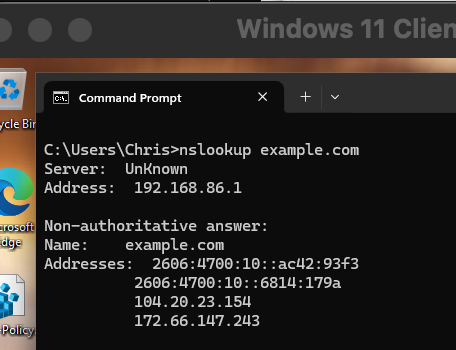

### 13. Verified Website Access

Opened Microsoft Edge and navigated to `https://example.com`.

Confirmed that the website loaded successfully without any connectivity errors.

This verified that normal web browsing was restored.

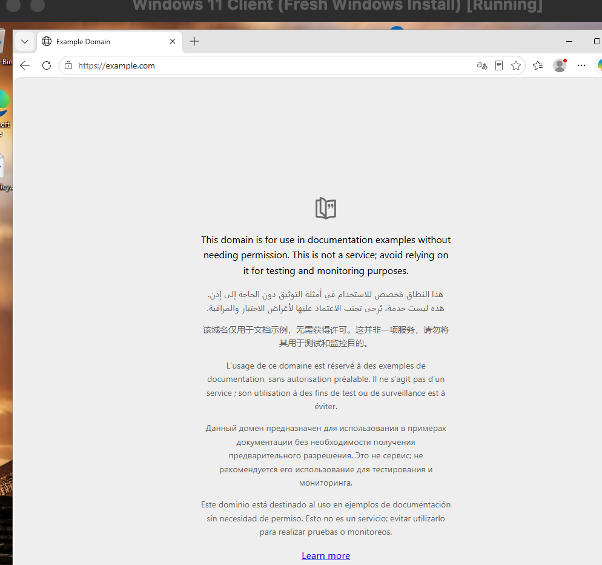

### 14. Confirmed Windows Network Status

Opened Windows Settings and navigated to **Network & internet**.

Confirmed that the Ethernet adapter was connected and Windows indicated that internet connectivity was available.

This provided an additional check that the original network connectivity issue was resolved.

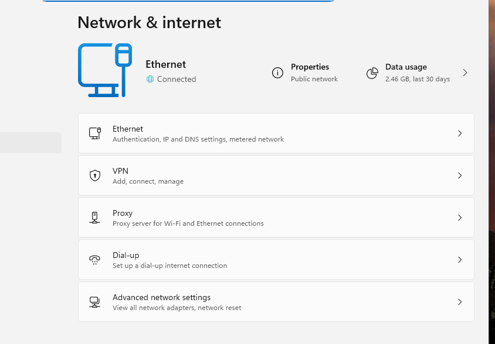


## Root Cause

The Windows 11 Client VM was configured with an incorrect static IPv4 default gateway of `192.168.1.254` instead of the correct gateway, `192.168.1.1`.

Although the VM had a valid IP address and subnet mask, the incorrect gateway prevented traffic from reaching destinations outside the local subnet.

Local network connectivity remained functional because devices on the same subnet could communicate without using the default gateway.

The IPv4 routing table confirmed that the default route (`0.0.0.0/0`) pointed to `192.168.1.254`, directing external traffic through the incorrect gateway.

DNS resolution also failed because the configured DNS servers were outside the local subnet and could not be reached through the incorrect default gateway.

The issue was caused by an incorrect network configuration rather than a physical connection failure or a confirmed DNS server problem.


## Resolution

Identified an incorrect static IPv4 default gateway of `192.168.1.254`, which prevented the Windows 11 Client VM from communicating with external IPv4 networks.

Opened the Ethernet adapter's TCP/IPv4 Properties and changed the settings to obtain an IP address and DNS server addresses automatically through DHCP.

After applying the changes, Windows received a new IPv4 address of `192.168.86.212` and default gateway of `192.168.86.1`.

The change in subnet occurred because the Mac host was connected to a different Wi-Fi network between troubleshooting sessions. The Windows VM used bridged networking, allowing it to receive its network configuration from the network connected to the host.

Confirmed that external IPv4 connectivity, DNS resolution, and website access were restored.


## Verification

Performed the following checks to confirm that the Windows 11 network connectivity issue was resolved:

- **IPv4 Configuration:** Ran `ipconfig /all` and confirmed that DHCP was enabled. Windows received a valid IPv4 address of `192.168.86.212` and default gateway of `192.168.86.1`.
- **External IPv4 Connectivity:** Ran `ping -4 1.1.1.1` and received four successful replies with 0% packet loss.
- **DNS Resolution:** Ran `nslookup example.com` and successfully resolved the domain using DNS server `192.168.86.1`.
- **Website Access:** Opened `https://example.com` in Microsoft Edge and confirmed that the website loaded successfully.
- **Windows Network Status:** Opened Settings > Network & internet and confirmed that Ethernet was connected and Windows indicated internet connectivity.

The original connectivity issue was no longer reproducible after restoring automatic network configuration through DHCP.


## Prevention and Recommendations

- Use DHCP for client computers that do not require a static IP address to reduce the risk of incorrect network settings.
- When configuring a static IPv4 address, verify that the IP address, subnet mask, default gateway, and DNS servers match the network requirements.
- Confirm that the configured default gateway matches the correct router address for the local subnet.
- Avoid manually changing network settings without verifying the correct values.
- After making network configuration changes, test local connectivity, external IP connectivity, DNS resolution, and website access.
- Document network configuration changes to make future troubleshooting easier.


## Ticket Documentation


Documented the troubleshooting process in osTicket, including the incorrect default gateway, failed external connectivity tests, and routing table findings.

Recorded the steps taken to restore automatic IPv4 and DNS configuration through DHCP and verify that internet connectivity was working again.

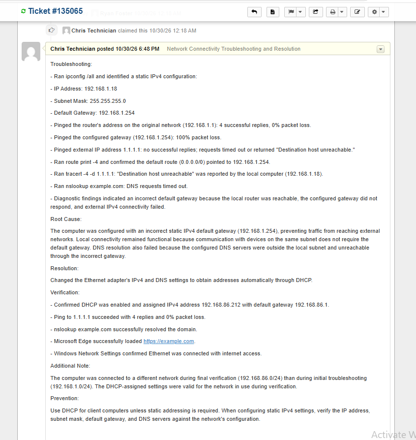


Replied to the user through osTicket to communicate that the network connectivity issue had been resolved.

Documented that the network settings were corrected and that external connectivity, DNS resolution, and website access were restored.

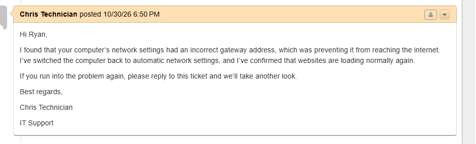


