# Ticket 06 — Linux SSH Service Failure

## Issue Description

A user, Leif Harvey, reported being unable to remotely access a Linux server from his Windows 11 computer using SSH.

When attempting to connect to the Ubuntu server at `192.168.1.30`, the SSH client returned the following error:

```text
ssh: connect to host 192.168.1.30 port 22: Connection refused
```

The user reported that SSH access had worked previously, but repeated connection attempts were unsuccessful. This prevented him from accessing log files needed for his work.

The objective was to identify why SSH connections were being refused, restore remote access to the Ubuntu server, and verify that the user could successfully establish an SSH session.


## Original Help Desk Ticket

The issue was documented in osTicket as Ticket #837900 after Leif Harvey reported being unable to connect to the Linux server through SSH.

The user previously had SSH access to the server, but connection attempts from his Windows 11 computer were now being refused. This prevented him from accessing the log files needed for his work.

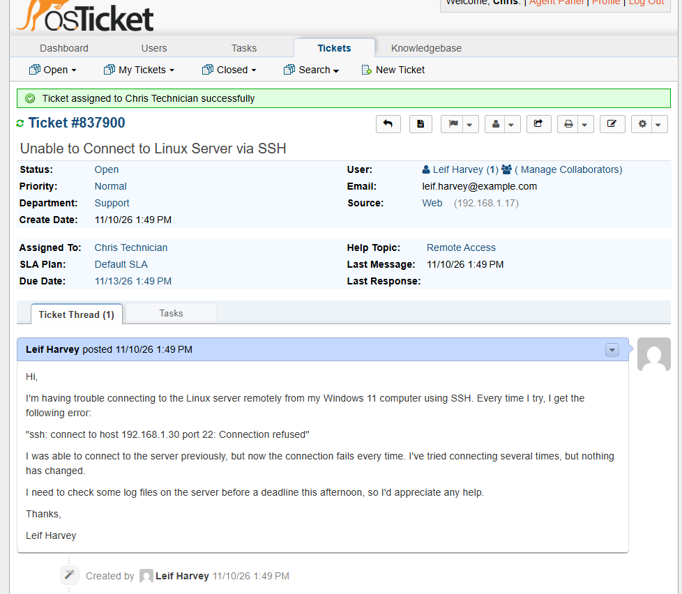


## Lab Environment

| Component | Details |
|---|---|
| Client Operating System | Windows 11 |
| Server Operating System | Ubuntu 25.10 |
| Virtualization | Oracle VirtualBox |
| Remote Access Service | OpenSSH Server (TCP Port 22) |
| Server IP Address | `192.168.1.30` |
| Ticketing System | osTicket |
| Troubleshooting Tools | Windows PowerShell, Command Prompt, `ssh`, `ping`, `Test-NetConnection`, `systemctl`, `ss` |


**Simulation Setup:** To reproduce the SSH connection failure, I first verified that the SSH service was running on the Ubuntu 25.10 server using `systemctl status ssh`.

I then successfully connected to the Ubuntu server from the Windows 11 client using `ssh chris@192.168.1.30`, confirming that remote access worked before introducing the issue.

To simulate an SSH service outage, I stopped the SSH service and its associated systemd socket using the following commands:

```bash
sudo systemctl stop ssh
sudo systemctl stop ssh.socket
```

Stopping `ssh.socket` prevented systemd socket activation from automatically starting the SSH service when a connection was attempted.

After stopping both components, SSH connection attempts from Windows returned `Connection refused`.


## Troubleshooting Steps

### 1. Reproduced the SSH Connection Failure

Opened Command Prompt on the Windows 11 client and attempted to connect to the Ubuntu server using:

```cmd
ssh chris@192.168.1.30
```

The connection failed with the following error:

```text
ssh: connect to host 192.168.1.30 port 22: Connection refused
```

This confirmed that the reported SSH connection issue could be reproduced.

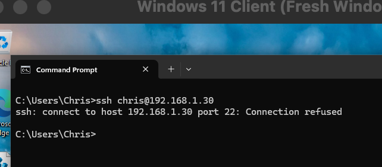

### 2. Tested Network Connectivity to the Ubuntu Server

Ran the following command from Windows:

```cmd
ping -4 192.168.1.30
```

Received four successful replies with 0% packet loss.

This confirmed that the Windows client could reach the Ubuntu server over the network, despite the failed SSH connection.

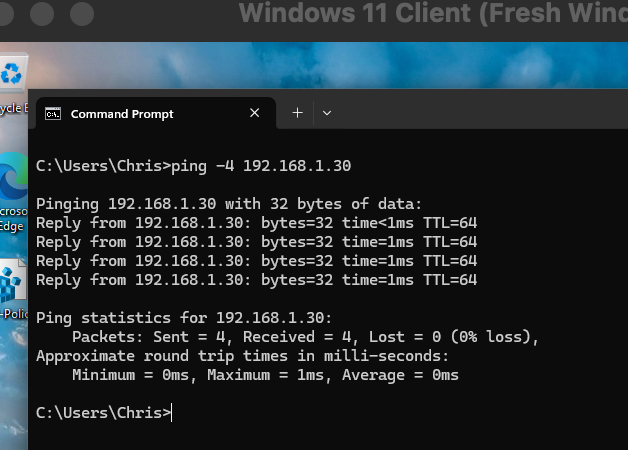

### 3. Tested TCP Port 22 Connectivity

Opened Windows PowerShell and ran:

```powershell
Test-NetConnection 192.168.1.30 -Port 22
```

The results showed:

- `PingSucceeded: True`
- `TcpTestSucceeded: False`

This indicated that the Ubuntu server was reachable, but TCP connections to port 22 were failing.

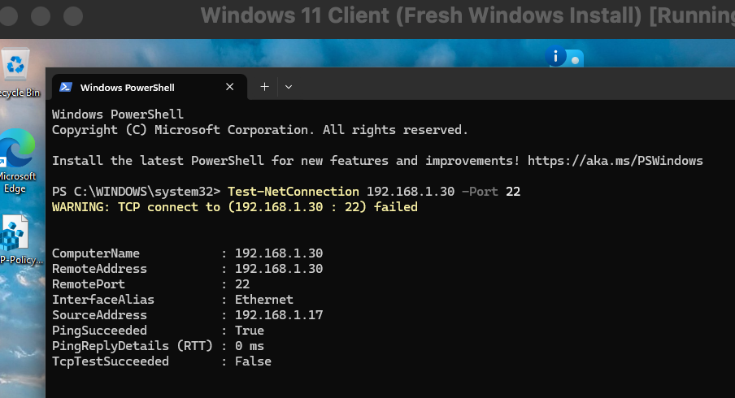


### 4. Checked the SSH Service Status

Opened a terminal on the Ubuntu server and ran:

```bash
systemctl status ssh
```

The SSH service showed `inactive (dead)`, indicating that the SSH daemon was not running.

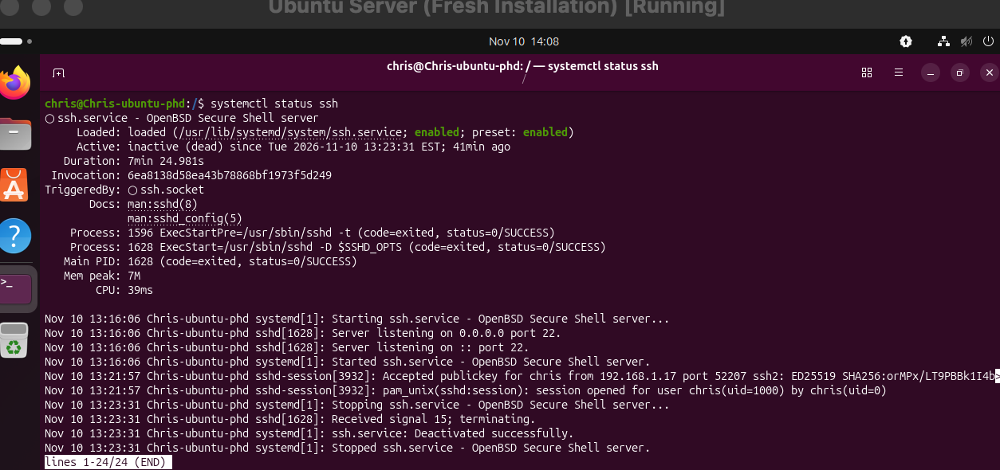

### 5. Checked SSH Socket Status

Ran the following command to check the associated systemd socket:

```bash
systemctl status ssh.socket
```

The socket also showed `inactive (dead)`.

This indicated that the socket was not available to accept incoming SSH connections or automatically activate the SSH service.

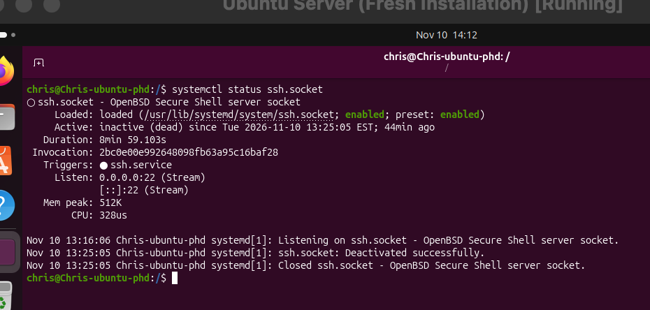

### 6. Checked for a Listening Process on TCP Port 22

Ran the following command to check whether any process was listening on TCP port 22:

```bash
sudo ss -tlnp | grep ':22'
```

The command returned no results, confirming that no process was listening on TCP port 22.

This explained why the Windows SSH client was receiving connection refused errors despite the Ubuntu server being reachable over the network.

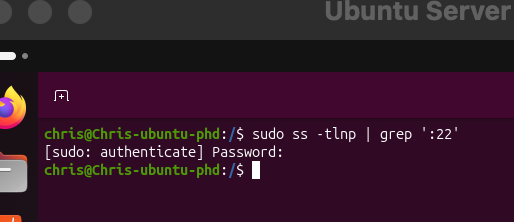

### 7. Checked SSH Startup Configuration

Ran the following commands to determine whether the SSH service and socket were configured to start automatically:

```bash
systemctl is-enabled ssh
systemctl is-enabled ssh.socket
```

Both commands returned `enabled`.

This confirmed that the SSH components were configured for automatic startup but were not currently running.

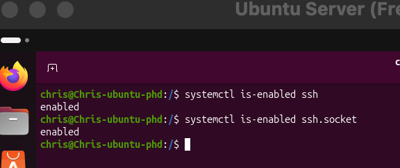


### 8. Restored SSH Socket Activation

After confirming that both the SSH service and socket were inactive, ran the following command on Ubuntu:

```bash
sudo systemctl start ssh.socket
```

This restarted the SSH socket, allowing the server to accept incoming SSH connections.

Checked the socket status using:

```bash
systemctl status ssh.socket
```

Confirmed that `ssh.socket` was `active (listening)` on TCP port 22.

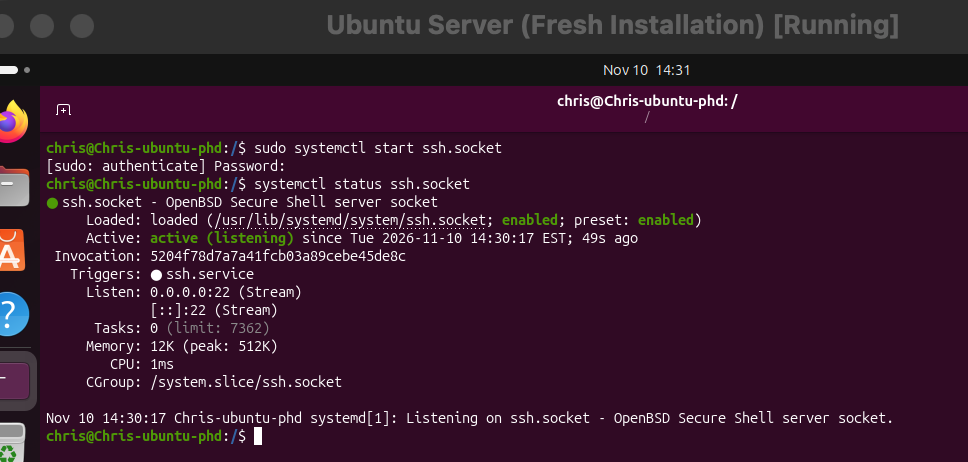

### 9. Verified TCP Port 22 Was Listening

Ran the following command:

```bash
sudo ss -tlnp | grep ':22'
```

Confirmed that TCP port 22 was listening on both IPv4 (`0.0.0.0:22`) and IPv6 (`[::]:22`).

This verified that the server was ready to accept incoming SSH connections.

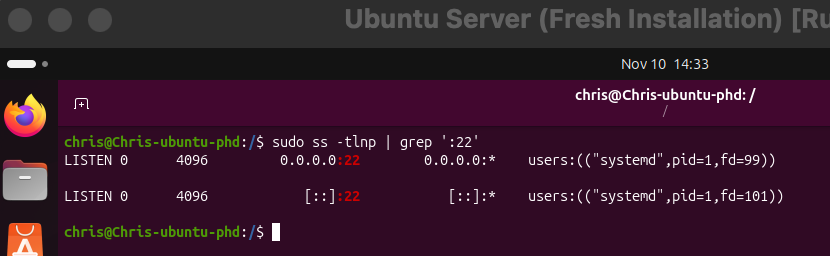

### 10. Retested TCP Port 22 Connectivity

Returned to the Windows 11 client and opened PowerShell.

Ran the following command:

```powershell
Test-NetConnection 192.168.1.30 -Port 22
```

The test returned `TcpTestSucceeded: True`, confirming that TCP port 22 was accessible from Windows.

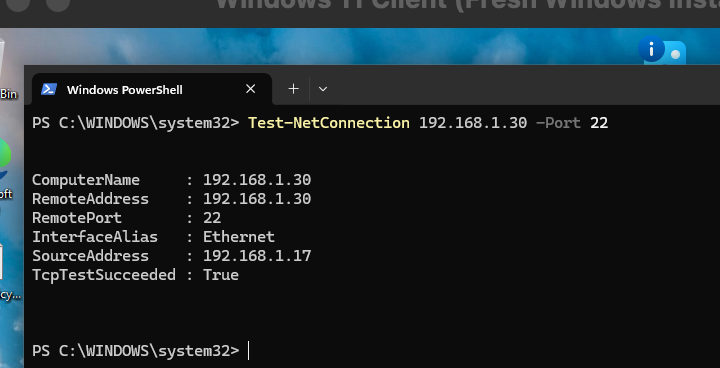

### 11. Verified SSH Service Status

Returned to Ubuntu and ran:

```bash
systemctl status ssh
```

Confirmed that `ssh.service` was now `active (running)` following the incoming connection test.

This showed that systemd socket activation had successfully started the SSH service.

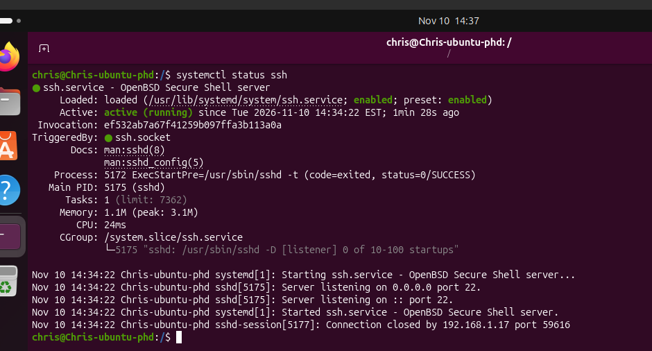

### 12. Verified Successful SSH Login

Returned to the Windows 11 client and attempted another SSH connection:

```cmd
ssh chris@192.168.1.30
```

The connection succeeded, displaying the Ubuntu welcome message and a remote shell prompt.

This confirmed that SSH access had been restored and the original connection refused error was no longer occurring.

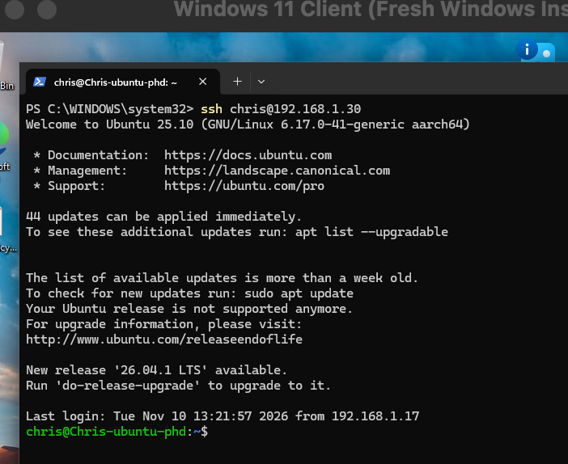


## Root Cause

The SSH connection failure was caused by the SSH service (`ssh.service`) and its associated systemd socket (`ssh.socket`) being stopped on the Ubuntu server.

Although the server remained reachable over the network, no process was listening on TCP port 22 to accept incoming SSH connections.

With `ssh.socket` inactive, systemd could not automatically activate the SSH service when a new connection was attempted.

Both SSH components were configured as `enabled` for automatic startup, but neither was running during the initial investigation.

The issue was caused by inactive SSH components rather than a general network connectivity failure or an identified SSH configuration error.


## Resolution

Restored SSH socket activation on the Ubuntu server using the following command:

```bash
sudo systemctl start ssh.socket
```

Confirmed that `ssh.socket` was `active (listening)` and that TCP port 22 was accepting connections again.

The SSH service was automatically activated following an incoming connection test from the Windows 11 client.

SSH functionality was restored without modifying firewall rules, network settings, or SSH configuration files.


## Verification

Performed the following checks to confirm that SSH access to the Ubuntu server was restored:

- **SSH Socket Status:** Confirmed that `ssh.socket` was `active (listening)` using `systemctl status ssh.socket`.
- **SSH Service Status:** Ran `systemctl status ssh` and confirmed that the service was `active (running)`.
- **TCP Port 22:** Ran `sudo ss -tlnp | grep ':22'` and confirmed that port 22 was listening on both IPv4 and IPv6.
- **Remote Port Connectivity:** Ran `Test-NetConnection 192.168.1.30 -Port 22` from Windows PowerShell and received `TcpTestSucceeded: True`.
- **SSH Login:** Successfully connected from Windows using `ssh chris@192.168.1.30`. The Ubuntu welcome message and remote shell prompt appeared.

The original SSH connection failure was no longer reproducible after restoring socket activation.


## Prevention and Recommendations

- Ensure that the SSH service and its associated systemd socket remain enabled for automatic startup when remote access is required.
- Avoid stopping or disabling `ssh.service` and `ssh.socket` unless necessary for maintenance or troubleshooting.
- Use `systemctl status ssh` and `systemctl status ssh.socket` to check service availability when SSH connections fail.
- Verify that TCP port 22 is listening using `sudo ss -tlnp | grep ':22'` before investigating more complex network or firewall issues.
- Consider implementing service monitoring to detect unexpected SSH downtime and alert IT staff before users report connection failures.
- When SSH components are enabled but inactive, check their current status and restore the appropriate service or socket without unnecessarily rebooting the server.


## Ticket Documentation

### Internal Note

Documented the troubleshooting process in osTicket, including the failed SSH connection, successful network connectivity tests, and inactive SSH service and socket.

Recorded the steps taken to restore SSH socket activation, verify that TCP port 22 was listening, and confirm that remote access was working again.

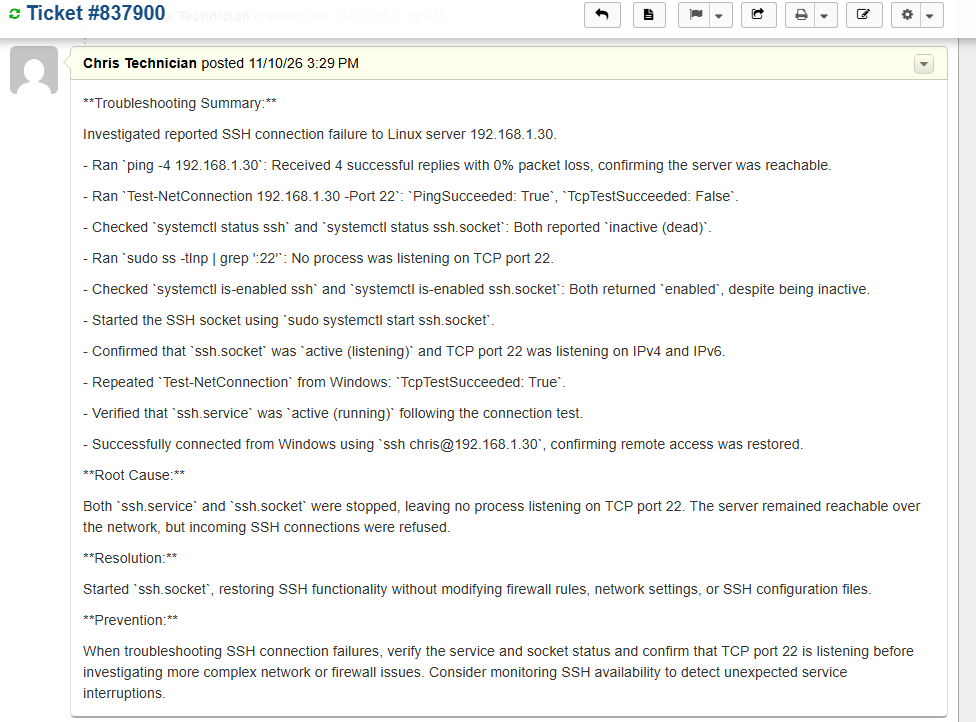

### User Reply and Ticket Closure

Replied to the user through osTicket to communicate that SSH access to the Ubuntu server had been restored.

Documented that the SSH service was functioning and that a successful remote connection had been verified from the Windows 11 client.

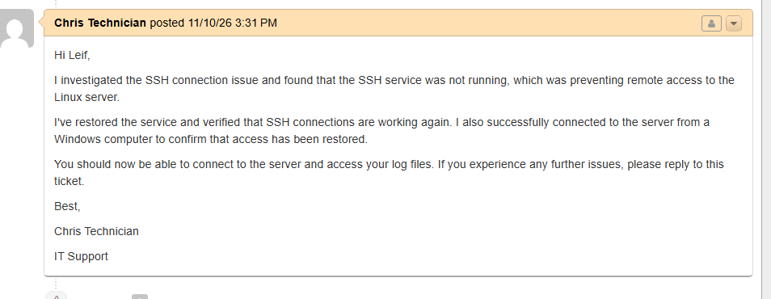


